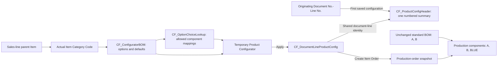
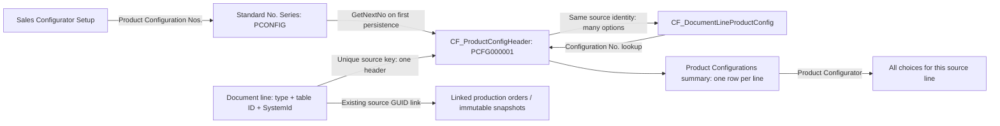
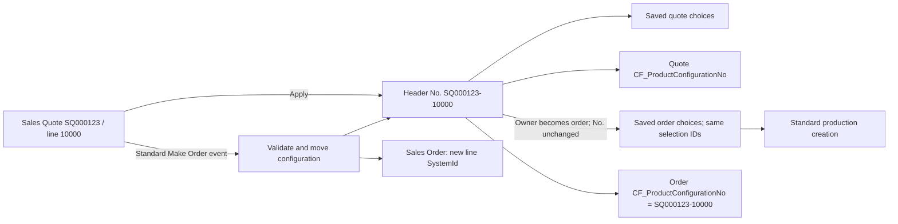

# Configure to Sales Order Create Production Order

## 1. Objective and status

Design a standalone **Product Configurator** popup for a sales order item line. The user selects options from two levels of setup. Each selected choice resolves to an existing Business Central item. When the standard sales-order planning action creates an Item Order, append those items to its production order components.

**Required example:** the sales line's parent item has a standard production BOM containing `A` and `B`. The user selects `WOOD -> BLUE`, whose item mapping is `Item."No." = BLUE`. The created production order must contain `A`, `B`, and a separate configured component `BLUE`.

The initial standalone AL implementation is now present in this project. This document records its design, delivered scope, and validation. It complements [Base App Sales Order to Production Order Flow](<Base App Sales Order to Production Order Flow.md>).

**Current version 1.0.0.38:** Fixes the document-type client-expression error when opening Product Configurator (section 39).

**Create Material Supply** reviews default-selected net material shortages and creates purchase/transfer orders using SKU/Item settings and a setup-controlled receipt policy (section 38). Product Configurator has a native-style **Availability** split button with standard item views, configured BOM-level availability and selected-sales-line Order Promising for current edits; late/unfulfilled ATP/CTP results use red row styling (section 37). Component items allow Inventory and Non-Inventory, matching native production BOM/component rules; Service remains unsupported and the finished root remains Inventory-only (section 36). Only directly added choice/manual rows use Favorable (green) styling; inherited BOM descendants retain normal styling (section 35 supersedes section 33's whole-branch highlighting). Diagram boxes support temporary whole-branch dragging and native card drill-down (section 34). Diagram up/down buttons collapse or expand one hierarchy level at a time (section 32). The diagram mounts inside the Business Central control-add-in container rather than below it (section 31). BOM draft generation prevents Work/Machine Center numbers from being looked up as items (section 30). **New Configured BOM** includes a read-only **Diagram** of the current draft with components/operations views, zoom and pan (section 29). Product Configurator shows matching **Routing Operation** numbers and descriptions beside each Routing Link Code (section 28). Editable **Base Routing** and **Base BOM** default using native item/SKU precedence and drive the configured structure and production (section 27). Setup selects **Item No.** or **Item Category** template assignment; persistent template headers and **Copy Template** are described in section 26, which supersedes the category-only design in section 13. Configuration numbers use the originating **Document No.-Line No.**, stored in **Code[100]** fields. Sales Quote configuration and standard Make Order transfer are supported; conversion retains the quote's original configuration number and template binding. Section 19 supersedes the historical number-series design in section 18. Sales Configurator Setup controls the production status and sales-line UI (sections 20-21). **New Configured BOM** uses private editable component drafts, native item/routing subtrees, and read-only Work/Machine Centre rows; committed component structures are used in production (section 25 supersedes the historical read-only preview in section 22). Choices support Item or Production BOM using native multilevel production (section 23). Mandatory Values is configured once per option, and Default Quantity is configured per choice and can be overridden in Product Configurator (section 17). Zero template defaults require users to enter a final quantity. Per-choice minimum/maximum quantity checking is described in section 24.

### Confirmed decisions

- Persistent template headers with two child setup tables, persistent document-line selections in `CF_DocumentLineProductConfig`, one numbered header per configured document line, and Sales Configurator Setup showing assignment and numbering policies.
- Include Document Type and source document/line identity so storage can support other documents. Sales Order was the initial integration; version 1.0.0.4 also supports Sales Quotes and their standard Make Order conversion.
- First version supports **Item Order only**. Block Project Order creation for a sales order containing configured lines.
- Quantity per unit means quantity per **finished item's base unit**.
- Always append a separate marked configured component, even if that item already exists in the standard BOM.
- Preserve configured components on standard Refresh Production Order.
- Block configuration edits once a linked production order exists.
- Use standalone `CF_` objects, with no runtime integration with the third-party configurator.
- All new AL object names use `CF_PascalCase`, contain no vendor prefix, and are at most 30 characters.
- Setup selects one template per sales-line item or per actual parent item category. Saved configurations retain their original assignment; no silent fallback or sales-line category override.
- Optional default choices are preselected for a first configuration and saved only when the user chooses Apply.

## 2. Two-level relationship and example

```text
Sales order line: parent item DESK-BASE, category DESK
    |
    +-- Level 1: CF_ConfiguratorBOM
    |       Category = DESK
    |       Option = WOOD
    |       Description = Wood finish
    |       Mandatory Values = Choice Code
    |
    +-- Level 2: CF_OptionChoiceLookup
            Category = DESK
            Option = WOOD
            Choice code = BLUE
            Item No. = BLUE
            Quantity per finished base unit = 1
            Selectable = Yes
                    |
                    +-- CF_DocumentLineProductConfig saves the selection
                            Document Type = Sales Order
                            Source Table ID = 37 (Sales Line)
                            Source Line SystemId = this sales line's SystemId
                            |
                            +-- Production Order: standard A, B + configured BLUE
```

Level 1 defines **what can be configured**. Level 2 defines **the available choices and their component items**. The saved selection belongs to an individual document line (initially a sales order line), not to the customer, category, parent item, or browser session.

| Category | Option | Choice | Component item | Quantity per finished base unit |
|---|---|---|---|---|
| DESK | WOOD | BLUE | BLUE | 1 |
| DESK | NUTS | HEX-M3 | SP-BOM1305 | 6 |
| DESK | LEGS | LEGS | LEGS | 4 |

Choice codes and item numbers may differ: `HEX-M3` resolves to `SP-BOM1305`. Never assume the choice code itself is an item number.

For 10 finished base units, selecting all three rows gives additional expected requirements of 10 BLUE, 60 SP-BOM1305, and 40 LEGS, in the selected component units of measure. Existing `A` and `B` requirements remain governed by the standard BOM.

## 3. Implemented objects and IDs

The project declares IDs **91000-91199** and targets **Base Application 29 / runtime 18**. The AL next-ID tool was rerun before implementation; all objects below use IDs from this declared range.

| Type | ID | Object name | Purpose |
|---|---|---|---|
| Table | 91000 | CF_ConfiguratorBOM | Level 1 option setup |
| Table | 91001 | CF_OptionChoiceLookup | Level 2 choice-to-item setup |
| Table | 91002 | CF_DocumentLineProductConfig | Saved selections per document line |
| Table | 91003 | CF_ProductConfigHeader | One numbered summary per configured document line |
| Table | 91004 | CF_SalesConfiguratorSetup | Singleton setup; original series field retained as legacy |
| Table | 91005 | CF_ConfiguredBOMLine | Temporary-only combined BOM preview lines; no SQL storage |
| Enum | 91000 | CF_ConfigDocumentType | Extensible document kind: Sales Order and Sales Quote |
| Enum | 91001 | CF_MandatoryValues | None, Choice Code and Quantity, or Choice Code |
| Page | 91000 | CF_ConfiguratorBOMSetup | Maintain options |
| Page | 91001 | CF_OptionChoiceLookup | Maintain choices; also use in lookup mode |
| Page | 91002 | CF_ProductConfigurator | Temporary worksheet popup |
| Page | 91003 | CF_CategoryTemplateDesigner | Category selector and linked option/choice grids |
| Page | 91004 | CF_CategoryTemplateOptions | Category-filtered option maintenance |
| Page | 91005 | CF_CategoryTemplateChoices | Choice maintenance for the highlighted option |
| Page | 91006 | CF_ParentRoutingLinks | Read-only lookup of links assigned to the effective parent routing version |
| Page | 91007 | CF_ProductConfigurations | Read-only numbered headers with source sales and linked production details/navigation |
| Page | 91008 | CF_PreviousSalesConfigs | Temporary same-item sales-line picker with removable customer filter |
| Page | 91009 | CF_SalesConfiguratorSetup | Display numbering policy and maintain default production order status |
| Page | 91010 | CF_ConfiguredBOM | Read-only effective BOM plus configuration additions |
| PageExtension | 91000 | CF_SalesOrderSubform | Product Configurator action on sales lines |
| PageExtension | 91001 | CF_ProdOrderComponents | Show configured-component markers on the standard component page |
| PageExtension | 91002 | CF_ItemCategories | Open template setup from Item Categories |
| PageExtension | 91003 | CF_SalesQuoteSubform | Quote configurator split button and saved configuration number |
| TableExtension | 91000 | CF_ProductionOrder | Source identity and immutable configuration snapshot |
| TableExtension | 91001 | CF_ProdOrderComponent | Mark and trace appended components |
| TableExtension | 91002 | CF_SalesLine | CF_ProductConfigurationNo, Code[100], on the source sales line |
| Codeunit | 91000 | CF_ConfiguratorMgt | Production snapshots, lifecycle subscribers, component application |
| Codeunit | 91001 | CF_DocumentConfigMgt | Source/choice validation, popup loading, selection persistence |
| Codeunit (Test) | 91002 | CF_ConfiguratorTests | Production creation, quantities, snapshots, refresh and guards |
| Codeunit (Test) | 91003 | CF_DocumentConfigTests | Document-selection and configurator validation tests |
| Codeunit | 91004 | CF_ConfiguratorUpgrade | Version-gated mandatory-rule migration and configuration-header backfill |
| Codeunit | 91005 | CF_ConfigHeaderMgt | Create/synchronize headers, migrate numbers, and move quote ownership |
| Codeunit | 91006 | CF_ConfiguratorInstall | Initialize setup/numbering and backfill retained data on installation |
| ReportExtension | 91000 | CF_ReplanProductionOrder | Explicitly block unsupported replan on configured orders |
| PermissionSet | 91000 | CF_Configurator | Sales configuration and setup read access |
| PermissionSet | 91001 | CF_ConfiguratorSetup | Setup maintenance, including sales configuration |

IDs can repeat across different object types. The allocator checks project syntax only; it does not prove absence of collisions with other installed extensions. Re-run it before adding more objects.

### Table 91000: CF_ConfiguratorBOM

Permanent shared setup, one row per category and configuration option.

| Field | AL type | Purpose |
|---|---|---|
| Item Category Code | Code[20] | Relation to Item Category |
| Configuration Option | Code[10] | Stable option identifier, e.g. WOOD |
| Option Description | Text[250] | User-facing description |
| Quantity per Unit (Legacy) | Decimal | Retained only to migrate existing defaults to choices |
| Display Order | Integer | Presentation order |
| Mandatory (Legacy) | Boolean | Original flag retained for historical upgrades |
| Mandatory Values | Enum CF_MandatoryValues | Requirement shared by every choice under this option; new options default to Choice Code |
| Enabled | Boolean | Enable the option for new configurations |
| Default Choice Code | Code[20] | Optional selectable choice within the same category/option, preselected on first configuration |
| Routing Link Code | Code[10] | Optional link to an existing parent routing operation |

Primary key: `(Item Category Code, Configuration Option)`. Secondary ordering key: `(Item Category Code, Display Order, Configuration Option)`.

Action **Choices** opens level 2 filtered to the selected category and option.

### Table 91001: CF_OptionChoiceLookup

Permanent choice mappings. First version supports item components only, so a custom choice-type enum is unnecessary.

| Field | AL type | Purpose |
|---|---|---|
| Item Category Code | Code[20] | Parent category |
| Configuration Option | Code[10] | Parent option |
| Code | Code[20] | Choice identifier, e.g. BLUE |
| Item No. | Code[20] | Required relation to an existing Inventory or Non-Inventory component item |
| Description | Text[250] | Choice display text |
| Variant Code | Code[10] | Optional variant of the component item |
| Unit of Measure Code | Code[10] | Valid component item UOM; default from the item |
| Display Order | Integer | Choice order |
| Selectable | Boolean | Whether this choice can be selected |
| Mandatory Values (Legacy) | Enum CF_MandatoryValues | Previous child-level rule retained only for migration |
| Default Quantity (stored as Quantity per Unit) | Decimal | Default component quantity in the selected UOM per finished base unit; nonnegative, defaults to 1; zero requires user entry before Apply |
| Min. Max. Quantity Behavior | Enum CF_MinMaxQtyBehavior | Disabled, both limits, minimum only, or maximum only |
| Minimum Quantity | Decimal | Inclusive minimum per finished base unit when enabled |
| Maximum Quantity | Decimal | Inclusive maximum per finished base unit when enabled |

Primary key: `(Item Category Code, Configuration Option, Code)`. Display order is not part of identity. Validate the category/option against level 1 and variant/UOM against the mapped item. Reuse the standard item's inventory calculation for optional lookup availability, with explicit location/variant filters.

Do not duplicate `No.` and `Item No.`. `Item No.` is the single authoritative mapping.

### Table 91002: CF_DocumentLineProductConfig

Permanent saved selections; the popup uses a temporary instance of this table.

| Field | AL type | Purpose |
|---|---|---|
| Document Type | Enum CF_ConfigDocumentType | Document kind; initially Sales Order |
| Source Table ID | Integer | Table containing the source line; 37 for Sales Line |
| Document No. | Code[20] | Source document number for display and filtering |
| Document Line No. | Integer | Source document line number for display and filtering |
| Source Line SystemId | Guid | Stable identity of the owning document line |
| Item Category Code | Code[20] | Category captured for validation |
| Parent Item No. | Code[20] | Detect parent-item changes |
| Parent Variant Code | Code[10] | Detect parent-variant changes |
| Configuration Option | Code[10] | Selected option |
| Option Description | Text[250] | Saved display description |
| Choice Code | Code[20] | Selected choice, or blank for an unselected optional option |
| Component Item No. | Code[20] | Resolved item snapshot |
| Component Variant Code | Code[10] | Resolved variant snapshot |
| Component UOM Code | Code[10] | Resolved UOM snapshot |
| Quantity per Unit | Decimal | Selected quantity per finished base unit |
| Routing Link Code | Code[10] | Selected routing link |
| Display Order | Integer | Popup ordering |
| Configuration No. | Code[100] FlowField | Lookup of the owning numbered header using document type, source table ID, and source line SystemId |

Primary key: `(Document Type, Source Table ID, Source Line SystemId, Configuration Option)`. Secondary document lookup key: `(Document Type, Source Table ID, Document No., Document Line No.)`. Use the row's standard `SystemId` as its selection identity when tracing generated components. Preserve it when updating an existing selection.

Document Type is an extensible custom enum, `CF_ConfigDocumentType`, supporting `Sales Order` (0) and `Sales Quote` (1). It is not the standard `Sales Document Type` enum: the integration maps the standard values explicitly. Future Purchase Order or other document kinds require their own adapters and must not be mislabeled as sales documents.

Source Table ID plus Source Line SystemId identifies the actual owning record. Document number and line number alone are insufficient because different document kinds can reuse the same numbers. Validate all five identity fields against the source record; do not accept arbitrary table IDs or document kinds in version 1. If a supported source document is renamed or renumbered, synchronize its display identifiers without losing the stable SystemId link.

Example saved identity: `Sales Order / 37 / 101011 / 10000 / <Sales Line SystemId>`, option `WOOD`, choice `BLUE`, component item `BLUE`. Current sales reads/writes/cleanup map Quote or Order to its custom document type and filter Source Table ID = 37. Production creation remains Sales Order only.

Two sales lines for the same parent item can have independent BLUE and RED configurations. Temporary/session-only storage cannot provide this isolation reliably after the popup closes.

## 4. Popup behavior

1. Add **Product Configurator** to the Sales Order Subform's **Manage** tab, after **Select items**, inside a **Configurator** split-button group; operate on the current persisted Order/Item line only. Product Configurator is the first/default action; future configurator actions belong in the same group.
2. Load enabled options for the parent item's category and overlay that line's saved selections into a temporary worksheet.
3. Show Option Description, Choice Code, Quantity per Unit, Component Item No., Description, Variant, UOM, and optional Routing Link Code.
4. Looking up Choice Code opens level 2 filtered to the exact category and option and to Selectable choices. Typed values must pass the same validation.
5. Selecting BLUE copies its mapped item BLUE and related variant/UOM into the temporary row. Do not change the parent sales-line item number or generate a configured item master.
6. **Apply Configuration** validates all rows and replaces this line's saved selections atomically, preserving existing selection identities. **Cancel** discards temporary edits.
7. Reopening shows the saved selections. Setup changes must not silently remap an existing saved choice.

Use setup pages to maintain the two levels; setup pages are not the sales-line selection storage. Do not put Session Id or Display Order into permanent record identity.

Version 1 allows one selected choice per option, with a positive editable quantity. Mandatory options cannot be left blank. Optional unselected options generate no component. Pricing, image sets, rule engines, sub-configuration trees, and resource choices are outside this version.

In Product Configurator, only the first column, **Configuration Option**, uses **Unfavorable (red)** for an enabled mandatory option while Choice Code is blank or the selected quantity is zero, and **Favorable (green)** once a choice and positive quantity are populated. All other columns retain normal styling. Preselected mandatory defaults with positive quantity are green immediately; zero template defaults remain red until completed. Clearing the choice restores red. Optional, disabled, or removed options retain standard styling. Requiredness is read from the option as described in section 17 and recalculated on each row refresh, including after typed/lookup selections and returning from template setup. Green indicates mandatory completeness only: existing mapping, quantity, and routing validations still apply, and permanent storage still requires **Apply Configuration**.

## 5. Production-order snapshot and traceability

Extend Production Order with source Document Type, Source Table ID, Document No., Document Line No., Source Line SystemId, source parent item/variant, configuration schema version, and a **configuration snapshot Blob**. The snapshot contains each selected option, its selection SystemId, resolved component item/variant/UOM, quantity per unit, and routing link. For the initial sales-order flow, capture Document Type = Sales Order and Source Table ID = 37.

Capture this once during creation, in the same transaction as the production order. It is authoritative for that order thereafter. Refresh must not depend on an open popup, current user session, mutable setup, or a still-existing sales line.

Extend Prod. Order Component with:

- `CF_ConfiguredComponent`: Boolean.
- `CF_ConfigSelectionId`: Guid, from the saved selection.
- `CF_ConfigOption`: Code[10].

Component identity for synchronization is production status/order/parent-line plus selection ID, not item number alone. Standard BOM rows stay unmarked. Separate options that resolve to the same item remain separate component rows.

Use a schema-versioned JSON payload in the Blob with explicit validation. Missing/corrupt payload on an order marked as configured is an error, not an empty configuration fallback. These fields must survive production status changes; verify the base transfer path and add a subscriber if the current version does not preserve them.

The implementation explicitly copies the snapshot through production status changes and reopening. A hidden `CF_RebuildAllowed` field grants permission to the standard creation/refresh calculation only within its database transaction. It is reset on successful completion; an error rolls it back with the rest of the operation. No session-global flag or extension COMMIT is used.

## 6. Integration with the base flow

The following event signatures were found in the project's dependency symbols. Event execution order was traced in the supplied Base Application 28 source. Confirm the same ordering in version 29 before implementation; symbol availability alone does not establish timing.

### A. Validate and snapshot before production lines are built

- `Create Prod. Order from Sale.OnAfterCreateProdOrderFromSalesLine(var ProdOrder, var SalesLine)` runs after the header fields are populated but before the standard header Modify and line-copy call in the traced source. Capture the Item Order snapshot here.
- `Create Prod. Order from Sale.OnBeforeCreateProdOrderLines(var ProdOrder, var SalesLine, var IsHandled, OrderType)` provides the explicit order type. Revalidate mandatory selections and item mappings before allowing standard line creation.
- For Project Order, inspect **all item sales lines on that order**, not just the line that triggered creation. Raise a clear error if any has saved configured choices. Leave unconfigured Project Orders unchanged.

Do not set IsHandled to bypass base creation. Do not use COMMIT; failed configuration validation must roll back the order being created.

### B. Append components after the standard BOM is complete

Subscribe to `Create Prod. Order Lines.OnAfterCopy(var ProdOrder, var ErrorOccured)`.

In the traced source this runs after standard line calculation and multilevel structure creation, but before the creation codeunit performs released-order flushing. Call a shared ApplyConfiguredComponents routine for orders with a snapshot. Abort on reported calculation errors rather than adding components to an incomplete order.

Resolve the parent production line from the item-sourced order and its root planning level, item, and variant. Require exactly one matching root line. Do not attach selections to unrelated multilevel child lines or assume a hard-coded Line No. of 10000.

The additions are flat component demand under that root line. They do not replace A/B, alter the item/SKU production BOM, or automatically explode a selected component into another production line. Configured subassemblies would require a separate design.

### C. Preserve additions on standard Refresh Production Order

Also subscribe to `Refresh Production Order.OnProductionOrderOnAfterGetRecordOnAfterCalcRoutingsOrComponents(var ProductionOrder, CalcLines, CalcRoutings, CalcComponents, var ErrorOccured)`.

This hook covers both full line recreation and component/routing-only refresh and runs before the report's released-order flushing in the traced source. Reapply from the header snapshot only when calculation succeeds.

The shared routine must be idempotent because full refresh can invoke both hooks:

- If a generated row is missing, recreate it once.
- If it exists with the correct values, leave it alone.
- If recalculation changes permitted values, update only that generated row through standard validation.
- Never delete or merge standard BOM rows.
- Reject changes that would conflict with actual consumption, reservations, warehouse picks, or finished production. Preserve base safeguards rather than bypassing them.

Do **not** append in `Create Prod. Order from Sale.OnAfterCreateProdOrder` or `Refresh Production Order.OnAfterRefreshProdOrder`: the traced source calls those after released-order flushing. The implementation additionally synchronizes at `Prod. Order Status Management.OnBeforeFlushProdOrder`, so configured components are present immediately before flushing.

## 7. Component insertion and quantity calculation

The implementation must use standard table validation and warehouse/reservation behavior, not direct assignments to expected/remaining/base quantities.

1. Lock the component table and scope line-number lookup to status, production order number, and parent production line.
2. Reuse `Prod. Order Component.InitNewLine` where suitable to obtain the current last line number, then allocate the next line in the standard 10000 increment.
3. Initialize a clean component with the correct parent keys; validate Item No., variant, component location, and item UOM.
4. Derive component location from standard parent/SKU component-location rules. Derive bin, flushing method, due date/time, dimensions, and costs through the standard component initialization patterns. Do not blindly copy the sales output bin to a consumption component.
5. Validate an optional routing link against an operation on this parent production order's routing.
6. Convert the configured quantity per finished **base** unit to the standard Quantity per representation, accounting for the production line's UOM conversion. Use standard expected/base quantity calculation and item UOM rounding.
7. Set trace fields and call `Insert(true)` only after required values are valid. Standard triggers must run.

For the first version, configured demand is linear, without additional configurator-specific scrap or fixed-quantity formulas:

`Expected component quantity in selected UOM = configured quantity per finished base unit x finished production quantity (base)`

The equality must be tested with the standard Quantity per calculation, not merely assumed. Expected Qty. (Base) must additionally reflect the component UOM factor. If the finished item uses BOX = 5 base units, producing 2 BOX with BLUE quantity per unit 1 requires 10 BLUE, not 2.

Implemented Quantity per is the configured quantity multiplied by the finished line's UOM factor. For marked components only, the `OnAfterProdOrderNeeds` subscriber supplies the finished line quantity without parent/routing scrap. Standard table validation still calculates and rounds expected/base/remaining quantities. Unmarked BOM components retain the standard scrap calculation.

The base AddItem helper inserts immediately; do not rely on it unchanged where it would insert a released component before quantity/location/trace fields are established.

## 8. Safeguards and boundaries

- Reject nonexistent, Service/unsupported-type, blocked, or consumption-blocked mapped items/variants. Inventory and Non-Inventory components are supported. Validate component UOM and routing links both when applying the popup and creating production.
- Zero inventory may be displayed as a warning; it is not itself a reason to reject an otherwise valid component.
- Block configuration changes through pages and table/service validation while any linked production order exists. Guard parent item/category/variant changes that would make saved selections stale.
- Document copy must not leave selections referencing the original Source Line SystemId or document identity. Version 1 does not automatically copy configurations; the destination sales order line must be configured explicitly.
- When an unlinked sales line is deleted, clean its saved selections. Production snapshots remain valid even after later sales posting/deletion.
- A new production order for the remaining unreserved quantity uses that output quantity, not the original full sales quantity.
- Manual production orders and orders without a CF snapshot retain base behavior.
- Adding components does not implicitly reserve them from inventory or auto-create component supply. Standard planning and warehouse processes remain responsible.
- Direct destructive calculation/line recreation, Replan Production Order, and Copy Production Order on configured orders are explicitly guarded. Use the supported standard Refresh Production Order path rather than bypassing snapshot preservation.
- Keep errors specific to sales order/line, option, choice, and item. No swallowed errors or success-shaped empty defaults.

## 9. Implementation sequence

1. Recheck free IDs, target-version event timing, component initialization, quantity conversion, and status-transfer behavior.
2. Implement the three minimal tables, the extensible document-type enum, setup pages, permissions, and data relations. Do not reproduce obsolete or unrelated fields from the supplied reference schemas.
3. Implement the temporary popup, choice filtering, explicit Apply/Cancel, persistent line selections, and lifecycle validation.
4. Implement header/component extensions and snapshot serialization with strict schema validation.
5. Implement creation and refresh subscribers with the shared idempotent append routine.
6. Guard unsupported production lifecycle operations and define permission separation between setup maintenance and sales configuration.
7. Add AL tests, build against version 29 dependencies, and validate the end-to-end flow in a sandbox. Publishing requires a separate implementation/deployment step.

The implementation uses no Insight Works tables/enums/pages. Its dependency has been removed from the app manifest; installed reference symbols/packages were not deleted or changed.

The supplied package's symbols expose separate option, option-choice, BOM, and BOM-buffer tables in addition to the supplied BOM v3 schema. This confirms the reference extension has more structures than the two illustrated UI levels, but symbol metadata and the supplied schema do not establish its complete persistence implementation. Use them as design references only; this plan does not copy or depend on its implementation.

## 10. Acceptance tests

| Test | Expected result |
|---|---|
| Standard BOM A/B; choose WOOD -> BLUE; create Firm Planned Item Order | A/B unchanged; exactly one marked BLUE component |
| Produce 10 base units; BLUE quantity per unit 1 | Expected BLUE quantity 10 |
| Finished UOM BOX = 5 base units; produce 2 BOX | Expected BLUE quantity 10 |
| Component UOM BOX = 2 BLUE base units; configured quantity 1 BOX; produce 10 finished base units | Expected quantity 10 BOX; expected base quantity 20 |
| Standard BOM already contains BLUE | Preserve that row; add a separate marked BLUE row |
| Two selected options resolve to BLUE | Two independent marked rows with different selection IDs |
| Two sales lines for the same parent select BLUE and RED | Each created Item Order contains only its own selections |
| Save a Sales Order selection | Document Type, source table, document number, line number, and SystemId match the source line |
| Same document/line numbers occur in another document kind | No cross-document configuration reads or writes |
| Unsupported document kind/table submitted in version 1 | Explicit validation error; no accidental sales-order interpretation |
| Supported source document is renamed/renumbered | Display identifiers updated; stable line identity and selections retained |
| Popup canceled | No saved configuration or component changes |
| Mandatory choice missing, invalid mapping, disabled choice, or stale parent item | Specific error; no partially created order |
| Unselected optional option | No configured component for that option |
| Partial sales-line reservation | Configured quantity scales to production output for only the unreserved remainder |
| Full refresh, component-only refresh, routing-only refresh, then repeat | Selections preserved; no duplicates; standard BOM remains standard |
| Change shared choice mapping after production creation | Refresh uses the immutable order snapshot, not the changed mapping |
| Create Released Item Order | Configured components exist before flushing; standard consumption/warehouse behavior runs |
| Change production status or post the sales order | Snapshot and component traceability retained |
| Edit configuration while linked production exists | Explicitly blocked |
| Configured order requested as Project Order, even when a different line triggers it | Explicitly blocked; no incomplete order |
| Manual/unconfigured Item or Project Order | Existing base behavior unchanged |
| Refresh conflicts with consumed/picked/reserved generated component | Explicit error; no bypass or destructive replacement |
| Malformed/missing configured snapshot | Explicit error; no silent component loss |
| Unsupported replan/copy/direct destructive recalculation | Explicit guard until snapshot preservation is implemented |

## 11. Using the implementation

1. Assign `CF_ConfiguratorSetup` to users maintaining setup and `CF_Configurator` to users configuring sales lines, in addition to their normal sales/manufacturing permissions.
2. Search for **Category Template Designer**, or select DESK in **Item Categories** and choose **BOM Template Setup**. Add WOOD in the Options grid, enable it, enter its default quantity, and choose **Save Option**.
3. Highlight WOOD. In **Choices for Selected Option**, add BLUE, map it to inventory item BLUE, select a valid variant/UOM, and choose **Save Choice**. Optionally set WOOD's **Default Choice Code** to BLUE and choose **Save Option**. The existing **Configurator Options** and **Configurator Choices** lists remain available.
4. On a saved sales order item line in that category, use the Lines **Manage** tab and the configurator split button after **Select items** to open **Product Configurator**, select BLUE, and choose **Apply Configuration**. Closing/canceling the popup does not save edits.
5. Use the standard Sales Order Planning **Create Prod. Order** action with **Item Order**. The standard BOM is unchanged; the generated component page shows the additional item and its configuration option.

The initial scope remains one choice per option, flat additional item components, no price changes or item generation, and no automatic configuration copying. Project Orders with selections, configured-order copying/replanning, and direct destructive line recreation are rejected explicitly. Standard status changes preserve the snapshot and markers.

Refresh does not override Business Central's reservation or warehouse safeguards. In particular, a full line refresh can be rejected by the base application when output is reserved to the sales line; component-only refresh should be used where permitted. Any picked, reserved, or consumed configured component blocks destructive refresh. Direct removal of a marked component is also blocked; this version does not provide a configuration cancellation workflow.

## 12. Verification results

- Final package build succeeded against the project's version 29 symbols with CodeCop and UICop enabled.
- The final project diagnostics contained **0 errors and 0 warnings**.
- The registered VS Code AL test controller ran both test codeunits together after the category-template, choice-lookup, and routing-link fixes: **63 passed, 0 failed**.
- The 13 production tests cover standard sales-to-production creation with A/B plus the selected component, separate same-item demand, idempotent synchronization, finished/component UOM conversions, linear demand without scrap, snapshot errors and source deletion, protected picked components, full/component refresh, direct recreation guards, production status transfer, and Project Order rejection.
- The 50 document-configuration tests cover selection validation, mandatory choices, per-line isolation, saved selection identity, changed mappings, linked-production restrictions, and temporary popup Cancel behavior. They also cover validated defaults, no persistence on opening, preserving saved/cleared choices, avoiding new default demand on existing configurations, real designer category/option filtering and option/choice/default creation, setup opened from the popup, preserving unsaved edits, empty-state guidance, and real popup Apply of an edited default.
- Three lookup regression tests select through the actual valid-values page, rather than typing a code. They verify immediate choice/component updates, exclusion of nonselectable/other-option choices, Apply persistence and reopening, preservation of an existing selection when the lookup is canceled, and no document save when the configurator is canceled.
- Eleven routing tests verify distinct assigned links only, location/variant SKU overrides, blank SKU fallback, standard variant initialization, certified versions at the shipment/due date, zero-date semantics, immediate rejection of invalid typed links, lookup Apply/Cancel, and empty-routing handling. One test calls the standard production line's `GetUpdateFromSKU` and compares both routing number and effective version with the configurator.
- Seven designer-routing tests cover inherited read-only sales-line context, standalone reference item/location/variant/date filtering and persistence, required reference item/date, category-change reference clearing, rejection of invalid typed defaults, and lookup cancellation.
- After adding mandatory-row styling, five new style tests and eight existing popup/default/lookup regression tests passed together: **13 passed, 0 failed**. The new tests assert the exact native style values for blank/populated/cleared mandatory choices, live mandatory-flag changes, optional and disabled options, preselected defaults, and independent row styling. AL TestPage does not expose rendered colors; browser rendering remains a visual acceptance check.

The custom Choice Code lookup returns the selected code through the page field's `OnLookup` `Text` parameter as well as updating the temporary row. Without that return value, the client could replace the selected code with the original blank text after the lookup closed. Selecting a valid choice now updates its component mapping immediately; permanent document storage still requires **Apply Configuration**.

The earlier test controller runs built/published the project to their configured test environment as part of execution. Test data remains subject to the test runner's transaction isolation; the refresh test selects the standard report's Update transaction type before creating fixtures, without committing them. The later changes in sections 15-17 have their own verification notes; the historical test counts above do not verify them.

Tenant-specific routing links, directed warehouse/bin behavior, and operational posting scenarios still require business acceptance testing with representative setup. The passing automated suite does not replace those checks.

## 13. Category default templates

Historical design through version 1.0.0.18. Section 26 supersedes the category-only assignment and temporary-header design below.

Each standard item category has one shared template represented by its existing `CF_ConfiguratorBOM` option rows and `CF_OptionChoiceLookup` mappings. There is no additional persistent template-header table. The designer uses a temporary copy of the selected standard Item Category as its header, so switching categories neither edits category master data nor changes any parent item's category.



### Designer and permissions

- Select a category in the designer header; highlight an option to filter the lower choices grid by both category and option.
- **Save Option** saves the option before adding its choices; **Save Choice** saves a mapping before using it as a default.
- A default must be selectable and resolve to a valid Inventory or Non-Inventory item/variant/UOM within the same category and option.
- Clear or change an option's default before deleting or disabling that choice.
- `CF_ConfiguratorSetup` grants template-table maintenance, designer-page execution, and read access to Item Category. It does not grant category-master write access. Normal item/sales/manufacturing permissions are still required.
- The sales popup's **BOM Template Setup** action requires setup write permissions and a nonblank actual parent-item category. Direct designer opening also checks both setup tables' write permissions.

### Default and refresh rules

- Opening a sales line with no saved configuration loads enabled options and their optional defaults into temporary rows only. No production demand is generated until selections are applied and an Item Order is created.
- Reopening preserves saved choices, quantities, routing links, selection identities, and deliberately cleared choices. Added options on an already-saved configuration are shown unselected, even if their template defines defaults.
- Returning from setup adds missing enabled options without overwriting existing temporary edits. Newly added options may receive defaults only while the line has no saved configuration.
- Changes to rows already loaded in the worksheet do not replace their temporary values. Reopen to load revised setup values for a fresh configuration; saved mapping changes still require explicit reselection.
- **Cancel** discards document-line edits only. Template maintenance is shared setup saved separately and is not undone by canceling the sales popup.
- An empty popup explains whether the parent lacks a category or the category lacks enabled options.
- Linked-production editing restrictions and immutable production snapshots remain unchanged; template changes never silently rewrite an existing production order.

## 14. Parent routing-link selection

In the sales-line popup, **Routing Link Code** opens **Parent Routing Links**, not the unrestricted routing-link master list. Only distinct, nonblank codes actually assigned to operations on the effective parent routing/version are offered. Selecting one updates the temporary row; **Apply Configuration** persists it. Canceling the lookup preserves the previous value.

Sales-line and category-designer lookup/validation share the same item/SKU/version resolver. `CF_DocumentConfigMgt.FilterParentRoutingLines` validates the persisted sales source before invoking that resolver:

1. Start with the parent Item's Routing No.
2. Apply the nonblank routing of the SKU for the sales location and blank variant, matching standard production-line initialization.
3. For a nonblank sales variant, apply its exact location/item/variant SKU's nonblank routing. An existing exact SKU with a blank routing retains the initially resolved route; a missing exact SKU resets the route to the Item, as the standard line does.
4. Use standard `VersionManagement.GetRtngVersion` with the sales **Shipment Date**, which becomes the Item Order's **Due Date**, and certified versions only. Do not replace a zero date with WorkDate. If no version is selected, the base routing header must be Certified.
5. Read only that routing/version's operations and collect their assigned routing-link codes.

Typed nonblank codes are validated immediately against the same context. Apply and production creation continue to revalidate stored selections. During component generation, the actual generated production-order routing remains the final authority, including any changes made by other extensions.

**Operation No. is not Routing Link Code.** Operation `100` is selectable as routing link `100` only if an operation on the effective routing/version has its **Routing Link Code** field explicitly set to `100`.

### Category Template Designer routing reference

- Opened from a sales-line configurator, the designer inherits the actual parent item, location, variant, and shipment/due date. These reference fields and the category selector are read-only in that context.
- Opened from Item Categories or Tell Me, select a **Reference Parent Item No.** in the selected category. **Reference Location Code** and **Reference Variant Code** are optional. **Routing Reference Date** initially uses WorkDate and must be nonblank before selecting a nonblank default link.
- The Options grid's **Routing Link Code** lookup offers only codes from that reference's effective routing/version. Typed defaults and **Save Option** validate against the same reference.
- Changing the category in standalone setup clears the reference item/location/variant so a previous category's routing cannot leak into the lookup. Without an item/date reference, nonblank routing-link selection is blocked; blank links remain allowed.
- The reference is temporary UI context only. It does not create an item-specific template or change the category/item/SKU masters. A default valid for one reference may still be invalid for another parent in the shared category; sales-line Apply and production creation continue to validate the actual parent context.

Existing invalid saved/default links are not silently removed or rewritten. Replace an incompatible default such as `100` through either filtered lookup, or clear it if no operation linkage is required. If the effective routing has no assigned links, the lookup explains that the field should remain blank or the routing must be maintained. The legacy standalone **Configurator Options** administration list has no reference header; its table-level master-link relation remains available for general setup maintenance.

## 15. Configuration actions, navigation, and deletion

### Sales-line Manage split button

The standard Sales Order Subform is a ListPart. Its **Manage** category is generated by the client for ungrouped Processing actions; it is not a named AL group. From version **1.0.0.3**, the extension adds the **Product Configurator** split-button group directly after the standard **Select Items** action using `addafter(SelectMultiItems)` and `ShowAs = SplitButton`. It does not create another Manage group, move Select Items, or introduce a Promoted area. The split button belongs alongside the standard actions in the existing Manage category:

1. **Product Configurator** is the default action.
2. **Create Production Order** opens the standard **Create Order From Sales** dialog, preselecting the status from Sales Configurator Setup (section 20).
3. **View Production Order** (from 1.0.0.5) opens the configured production order linked to the selected sales line. One link opens its status-specific standard card; several links open the filtered standard Production Order List. If no configured order is linked, the existing navigation error explains this instead of opening an unrelated order.
4. **Product Configurations** opens the saved-configuration list.

Creation uses the persisted selected sales line, requires Shipment Date and positive outstanding unreserved base quantity, and checks production replenishment/output blocking for the item, exact location/variant SKU, and variant. The standard replenishment helper is internal to Base Application and cannot be called by this extension, so the precheck follows its same SKU-or-item fallback and output-blocking rules. The actual creation delegates to the standard **Create Prod. Order from Sale** codeunit. Standard numbering, status/order-type selection, BOM/routing calculation, reservations, flushing, and CF snapshot/component subscribers remain in place. Existing linked orders do not prohibit additional production for outstanding unreserved demand. Configured Project Orders remain unsupported.

### Product Configurator window

- Opening a configuration with linked CF production orders displays a read-only notice and linked order number/status.
- **Linked Production Orders**, also available by drilling down on the displayed number, opens the matching status-specific card for one order or a filtered standard list for multiple orders.
- **Delete Configuration** deletes every saved option for this source sales line, not the sales line itself, after confirmation. It discards the popup's unsaved edits by closing after successful deletion.
- If any linked order remains, deletion is refused with a popup offering navigation to the orders. Delete all linked orders first. Navigation returning to the popup refreshes the linked/read-only state.
- If no configuration has been saved, the action explains that Cancel discards unsaved choices.
- Deletion rechecks the source and linked orders under the existing source/configuration locks and retains table-level configuration-edit protection.
- Deleting a production order never automatically deletes its saved sales-line configuration. Once all links have gone, the configuration can be edited, explicitly deleted, or reused for another eligible production order.

### Production-order deletion

On the standard simulated, planned, firm planned, released, and finished production cards and lists, and the generic Production Order List, a linked saved configuration adds a **Yes/No** warning:

> Linked sales order line product configuration exists. Do you still want to delete the production order?

The default answer is No. Yes permits the normal page deletion to continue; it does not bypass any Base Application table triggers, reservations/warehouse confirmations, posted item/capacity entry checks, subcontracting purchase-order checks, permissions, or other base validation. No cancels deletion and optionally opens the linked configuration list.

The warning is a page-event subscriber only: programmatic/background order deletion does not produce this custom GUI prompt. The old configured-component table delete restriction has moved to the Components page, so it cannot obstruct a standard whole-order deletion cascade or status transfer. Individual configured components remain protected against direct deletion in that page. Snapshot identity, destructive-recreation guards, and processed-component rebuild checks remain unchanged. No new deletion bypass flag or COMMIT has been added.

### Product Configurations list

Page **91007 CF_ProductConfigurations** is available through Tell Me and the sales-line split button. From version **1.0.0.2**, it uses **CF_ProductConfigHeader**, with one row per configured document line instead of one row per saved option.

Columns include configuration number, document type/number/line, customer number/name, parent item/variant, current sales description/quantity/UOM/location/shipment date, category, saved-option count, header creation timestamp, and linked production order number/status/count. Drill down on Configuration No. or Saved Options, or use Product Configurator, to open the selected line's choices. Links use document type, source table, and source line SystemId, not item number or document line number alone. When several orders are linked, the displayed number is one representative order and navigation shows all matches.

The list is read-only. Actions open the Sales Order, Product Configurator, or linked production orders, or explicitly delete the entire selected source line's saved configuration. The **Source Sales Line Exists** column identifies unavailable source details rather than associating an orphaned selection with a different sales line.

### Verification and manual acceptance

No automated tests were created or run for this change, as requested. The analyzer-enabled package build succeeds with zero project errors/warnings. Publishing to the configured sandbox was approved. Integrated-browser verification was skipped at the user's request after Microsoft sign-in was required.

Verify in the sandbox before business use:

1. Refresh/reopen the Sales Order and check there is only the standard Manage category, containing Product Configurator alongside the existing actions. Check its split-button dropdown still includes Create Production Order and Product Configurations.
2. Create an Item Order from the selected configured line; confirm the standard dialog, unreserved output quantity, and standard BOM plus configured components.
3. Cancel creation and confirm no order is created; verify full reservation or production/output blocking prevents creation.
4. Open a linked configuration, check its notice/read-only state, and navigate to one or several linked orders.
5. Try configuration deletion while linked; confirm nothing is deleted and navigation is offered.
6. Delete a permitted production order through its standard card/list: No preserves it; Yes still executes base validation. Confirm posted-entry/purchase-order/warehouse restrictions remain effective.
7. Confirm saved configuration remains after order deletion and becomes editable only when its last link is gone. Delete configuration explicitly and verify all its options disappear without deleting the sales line.
8. Open Product Configurations through Tell Me; verify source/customer details, link counts, drilldowns, and source-line-wide deletion.

## 16. Load Previous Sales Configuration

The Product Configurator toolbar includes **Load Previous Sales Configuration** after **BOM Template Setup**. It opens page **91008 CF_PreviousSalesConfigs**, a temporary Sales Line list with one row per configured source sales line, rather than one row per option.

- Only other retained Sales Order lines with saved configuration and the **same parent Item No.** are offered. The current line is excluded.
- The picker initially filters by the current line's **Sell-to Customer No.**. Use **Clear Customer Filter**, or remove/change the customer filter in the filter pane, to select another customer's configuration.
- The same-item restriction is enforced independently of the removable customer filter. Parent variants need not match, but loaded choices and routing must be valid for the current line.
- Columns show configuration number, previous order/line, customer number/name, order date, parent item/variant, description, quantity/UOM, location, shipment date, and saved-option count. **View Saved Configuration** opens the selected line's summary; Product Configurator there opens its choices.
- This is not an archive. Only configurations still retained in the document-selection table are available; posting/deleting a source line currently removes its saved selections. Deleted source lines are excluded.

Selecting a row prepares the complete saved configuration and asks for confirmation to **replace** the current temporary selections. Picker cancellation, declining confirmation, or a validation error leaves the current choices unchanged.

Loading clears current choices and resets active option quantities/routing defaults from the current category template before copying the previous line's choices, quantities per finished base unit, and routing links. Options present only in the current template stay unselected; newly mandatory options must be completed before Apply. Obsolete saved target options remain cleared so the existing Apply logic can remove them explicitly.

The loader validates current option/choice availability, component item/variant/UOM mapping, positive configured quantities, and the current parent item/SKU/date routing context. A changed saved component mapping or incompatible routing produces an explicit error; it is not silently remapped or dropped. Loading from a production-linked previous line is allowed for reading, but the target line must be editable and unlinked.

The current sales order, line identity, parent item/variant, sales quantity/UOM, location, and shipment date are not copied from the previous order or changed. Existing target selection IDs are preserved, new options receive target-owned IDs, and previous selection/source IDs are never reused as target identities. All work occurs in temporary buffers: source selections, saved target selections, and production snapshots remain unchanged until **Apply Configuration** saves the current line. Closing with Cancel discards the loaded choices.

No automated tests were created or run for this addition. The CodeCop/UICop package build succeeded with zero project errors/warnings. After sandbox publishing, connected-environment discovery confirmed page 91008 CF_PreviousSalesConfigs is installed in this app. Browser acceptance remains outstanding.

Manual acceptance:

1. Confirm the default picker shows only saved same-customer/same-item configurations and excludes the current line.
2. Clear the customer filter and verify other customers appear while different items remain excluded.
3. Preview a previous line's saved choices and load it; confirm all its options are copied, not just one selected option.
4. Decline replacement or cancel the picker; verify existing temporary edits remain intact.
5. Load and then cancel the configurator; verify neither source nor saved target configuration changes.
6. Load and Apply; reopen and verify the copied selections belong to the target line, with its unchanged sales quantity and context.
7. Check changed/blocked mappings, obsolete options, invalid quantities, and incompatible target routing reject loading without partial replacement.
8. Confirm production-linked targets cannot load previous choices, and new mandatory template options remain red until populated.

## 17. Option-level Mandatory Values and choice-level quantity

**Mandatory Values** is configured on the upper **Options** grid and in the standalone Configurator Options list. The rule applies to **all choices under that option**; choices cannot override it. The lower **Choices for Selected Option** grid and standalone choices list instead contain **Default Quantity**, after Description. This initializes the editable **Quantity per Finished Base Unit** in Product Configurator; users can change the selected quantity without changing the setup default.

| Value | Behavior |
|---|---|
| None | The option is optional. |
| Choice Code | The option requires one selected choice. This is the default for new options. |
| Choice Code and Quantity | The option requires one selected choice and a positive quantity, regardless of which choice is selected. A positive default satisfies the quantity requirement; manual re-entry is not required. |

Requiredness is read live from the option, not derived from child rows. Selecting any valid choice fulfills the option's choice requirement. A mandatory option remains mandatory even if no selectable choices are available, so maintain a valid selectable choice before using it. Disabled options are excluded.

For example, WOOD can offer BLUE with quantity 1 and GREEN with quantity 2. Setting WOOD to Choice Code makes either choice satisfy the same requirement. Selecting BLUE initializes the sales configuration quantity to 1; selecting GREEN initializes it to 2. Sales users can still override the selected quantity. Explicitly selecting or reselecting a choice uses that choice's current default; reopening an existing configuration preserves its saved quantity. Adding another choice does not change WOOD's mandatory rule.

The sales popup shows required-value indicators on Choice Code and, for Choice Code and Quantity options or selected zero-quantity defaults, Quantity. Color styling remains confined to the first Configuration Option column. Mandatory options with zero selected quantity remain red until a positive quantity is entered. Optional rows remain neutral. Apply and production creation enforce the same option-level rule. Every selected component must have a positive final quantity, including in None or Choice Code mode. Template defaults may be zero to force user entry.

### Upgrade and existing settings

Version **1.0.0.12** adds field 10 **Mandatory Values** on **CF_ConfiguratorBOM** and field 12 **Quantity per Unit** on **CF_OptionChoiceLookup**. The previous option quantity and child mandatory fields remain hidden, read-only legacy fields to preserve upgrade compatibility; neither controls current runtime behavior.

Upgrade codeunit **91004 CF_ConfiguratorUpgrade** runs the relocation once per company when upgrading data older than 1.0.0.12:

- Each existing choice inherits its old parent option's quantity.
- The option inherits the strictest previously selectable child rule: Choice Code and Quantity, then Choice Code, then None. Options without selectable children remain optional during migration. After migration, every child inherits the single parent rule.
- Earlier upgrade steps still run first when upgrading older releases.
- Existing item/variant/UOM mappings, default choice codes, saved document selections and their quantities, selection identities, and production snapshots are not rewritten.
- Later upgrades skip this migration, preserving subsequent per-choice quantities and option rules.

### Verification

Existing mandatory/style cases and the designer regression were updated for the relocated fields. No new automated tests were added and tests are not run for this change, as requested.

Manual acceptance: verify the mandatory dropdown appears only above, quantity appears only below, changing the parent rule affects every child, selecting choices with different quantities initializes the corresponding quantity, saved/previous configuration quantities remain preserved, and migrated setup retains its prior defaults.

## 18. Numbered document-line configuration headers

Version **1.0.0.2** adds a persistent header and numbering setup without changing the selection identity or production snapshot schema.

**Historical design:** the number-series generation and Code[20] header number described below applied to 1.0.0.2-1.0.0.3. Version 1.0.0.4 replaces them with Code[100] document/line numbers and a sales-line reference, as described in section 19. Existing PCONFIG series records are not deleted or reused for new configuration numbering.

### Tables and relationships

**91003 CF_ProductConfigHeader**:

- Primary key: **No.**, Code[20], generated automatically.
- Unique secondary key: **(Document Type, Source Table ID, Source Line SystemId)**. This enforces exactly one header for each configured source line, even if several options or concurrent callers target it.
- Stored context: document number/line, parent item/variant, item category, and the number series originally used.
- **Saved Options** is a count FlowField over the child selection rows.
- Number, original number series, and owning document-line identity cannot be renamed/reassigned.

**91004 CF_SalesConfiguratorSetup** is a per-company singleton with an empty primary key and **Product Configuration Nos.**, a Code[20] relation to an automatic standard No. Series. Page **91009 CF_SalesConfiguratorSetup** is available through Tell Me and the configuration summary's setup action. Setup maintenance requires CF_ConfiguratorSetup; normal configurator users can read numbering setup.

Child selections keep their existing composite primary key and SystemIds. Their new field 18 **Configuration No.** is a lookup FlowField into the header's unique source key, rather than a second stored ownership value that could drift or require rewriting locked production-linked selections.



The header's generic source key supports future document kinds, including reused document/line numbers in different source tables. Current editing, creation, and source navigation still support Sales Order/Sales Line only; new document types require their own adapters.

### Number generation and lifecycle

The approved default series is **PCONFIG**, with starting number **PCFG000001**, increment 1, and automatic numbering. Installation/upgrade initializes the singleton and creates this series only if it does not already exist. Existing nonblank setup is retained; an existing PCONFIG series is reused without overwriting its lines, and must support automatic numbering.

- Opening/canceling a new configurator does not create a header or request a number.
- First persistence of saved options creates the header through the standard **No. Series.GetNextNo** API, in the same transaction as the choices.
- Reapplying/editing choices, adding options, or loading another line's previous configuration keeps the target header number. Active replacement options are saved before obsolete rows are removed, avoiding accidental header recreation during Apply.
- A different source line gets its own header and number, even for the same item/customer.
- Source document renumbering synchronizes header display context through the existing selection-update flow, while retaining its number and source SystemId.
- Explicit configuration deletion removes all choices and the header. The existing production-link guards remain. Deleting/posting the source sales line also cleans up the header after its final selection is removed; production snapshots remain independent.
- Removing the final saved option removes the now-empty header. This is not a configuration archive.
- Missing/invalid setup or a conflicting/exhausted number series raises the standard error; no fallback/manual number is silently generated. Number allocation follows the standard series settings, including its gap policy.

### Upgrade

For data older than 1.0.0.2, upgrade initializes numbering and backfills one numbered header per existing saved source line, including configurations already linked to production. Child rows, selection IDs, component mappings, quantities, mandatory modes, and production snapshots are not rewritten. Header Created At is the backfill timestamp for old configurations, not their original application date.

The version gate prevents repeat backfill on subsequent upgrades. The older mandatory-rule migration retains its separate 1.0.0.1 gate, so upgrading from 1.0.0.1 does not reset user-edited choice modes.

### Verification and acceptance

No new automated tests were created. Fourteen existing persistence, isolation, cancellation, linked-production, deletion, creation, refresh, and status-change regressions passed. The CodeCop/UICop build was clean.

In the sandbox, verify:

1. Sales Configurator Setup points to PCONFIG; its line starts at PCFG000001.
2. Existing COLOUR/SIZE choices on three sales lines appear as **three** numbered summary rows, not six.
3. Product Configurator opens all choices for the selected header, and reapplying preserves its number.
4. Canceling a new configuration leaves no header; applying creates one.
5. Loading previous choices retains the current target's number, not the source's number.
6. Linked-production navigation/warnings open the filtered header summary, and normal deletion guards remain.
7. Deleting a configuration/source removes its header and selections while preserving independent production snapshots.

Visual rendering and representative business-data backfill values require manual acceptance.

## 19. Document-line numbers and Sales Quote Make Order

### Number format and sales-line field

New configurations use **Document No.-Line No.**, for example **101001-20000** or **SQ000123-10000**. Header No., the selection Configuration No. lookup, and **Sales Line.CF_ProductConfigurationNo** are all **Code[100]**.

Apply creates the header on first persistence and writes its number to the unique source sales line. Reapplying keeps the same number. A later source renumbering or Quote Make Order updates source identity/display context, not the already-created configuration number.

The source link remains **(Document Type, Source Table ID, Source Line SystemId)**. Numbers cannot be manually assigned to a different sales line: reference writes must match its authoritative header. Ordinary copied/new sales lines have copied references cleared; Make Order is the explicitly supported transfer path. Deleting the last selection clears the surviving source line's reference as well as deleting its empty header.

The exact requested format is retained. Quotes and orders can have overlapping document-number namespaces; if the resulting number is already owned by another configuration, Apply/upgrade raises an explicit collision error. No type prefix, suffix, fallback number, or existing configuration overwrite is applied.

Sales Configurator Setup now displays the fixed numbering policy. Its old series field and the header's old No. Series field remain only for schema compatibility/migration; they are not used to generate new numbers. Existing standard number-series master records are left untouched.

### Configure a quote, then Make Order

Sales Quote Subform now has the same native Manage placement for **Product Configurator** and **Product Configurations**, without a custom Manage category. Both quote and order lines display the read-only saved configuration number. Quote configuration uses SalesQuote in the custom enum and the quote line's actual SystemId; routing/default/mandatory validation remains shared.

The subscriber uses the standard **Sales-Quote to Order.OnAfterInsertSalesOrderLine** event, with the actual source quote line and inserted order line supplied by Base Application:

1. Read the quote's saved choices and validate both quote and new order context.
2. Prepare order-owned selections with unchanged choice mappings, quantities, routing links, and selection SystemIds.
3. Move the existing header to SalesOrder and the new order line's SystemId, keeping its original No. and header SystemId.
4. Remove the old quote selection rows, then save the prepared order selections with their preserved SystemIds.
5. Save the original configuration number in the order line's **CF_ProductConfigurationNo**. Clear the old quote line's reference if it still exists.

The transfer runs inside the standard conversion transaction without a custom COMMIT, deletion bypass, or manual Make Order replacement. A validation error aborts conversion rather than dropping/remapping choices. Standard customer, approvals, archive, reservations, quote deletion, and other Base Application behavior still runs.

Base Application normally deletes the converted quote. If another extension retains it, the configuration has still been **moved**, not duplicated: the order owns it, and the retained quote has no saved configuration reference/choices. Recreating a configuration on that quote with its original number can produce the explicit collision error above.

Production creation remains restricted to Sales Orders. The converted order is configured immediately, so its normal production creation flow uses the transferred selections without asking the user to recreate them.



### Upgrade and verification

The **1.0.0.4** upgrade preflights collisions, renames legacy series-based headers to their document/line numbers, and backfills each surviving source sales line's new field. Header SystemIds, child selection identities, component mappings, quantities, mandatory modes, and production snapshots are preserved. Renaming is restricted to this version-gated legacy migration; later upgrades retain quote-origin numbers after conversion.

No new automated tests were created. Fourteen existing save/isolation/cancellation/deletion/production regressions passed. They validate existing behavior but do **not** exercise the new Make Order transfer. The user chose to perform the new-flow browser check manually.

Manual acceptance:

1. Existing order configurations show Document No.-Line No. and the same value on their sales lines.
2. Apply a quote with multiple options; confirm one header, Code[100] fields, and its saved quote-line reference.
3. Use standard Make Order; confirm the order line retains the quote-origin number, all choices/quantities/routing remain, and the single header points to the order line's SystemId.
4. Reopen the order configurator and create production normally; confirm additional configured components.
5. Cancel conversion or cause validation failure; confirm no partial ownership/choice transfer.
6. Try an overlapping document/line number; confirm a clear collision error and no overwrite.
7. Delete an editable configuration; confirm its source reference is cleared. Ordinary line copying must not inherit it.

## 20. Default production order status

Version **1.0.0.6** adds **Default Production Order Status** to Sales Configurator Setup, in its Production group. Field 3 uses the standard **Create Production Order Status** enum, with only **Planned**, **Firm Planned**, and **Released** allowed. Blank/invalid values are rejected during setup validation and before opening the creation dialog.

New setup records and the one-time upgrade initialize the default to **Firm Planned**, preserving the previous Base Application default. Later publishing/upgrades do not reset the user's selected status.

The sales-line configurator's **Create Production Order** action reads and validates setup, then calls the standard **Create Order From Sales.SetParameters** before opening the dialog. It keeps **Item Order** as the initial order type. Users can change the preselected status in the dialog; the final selected parameters, not an enforced setup value, are passed to the existing standard production creation codeunit. Cancellation, demand checks, production-component logic, and base validation remain unchanged.

This setting applies to the configurator's creation action. It does not globally override unrelated Base Application dialogs, planning processes, or manual production-order cards. Setup changes require the existing CF_ConfiguratorSetup permission set; normal configurator users can read the default.

No new automated tests were created. Verify manually by selecting each allowed status in setup, opening Create Production Order, and checking the corresponding radio option is preselected. Also check changing the dialog choice and canceling creation.

## 21. Enable the sales-line product configurator

Version **1.0.0.8** replaces the previous column-only switch with one **Enable** Boolean under **General** on Sales Configurator Setup. Field ID **4** is retained and renamed, preserving the previously saved Boolean value without deleting data.

New setup records default to **false**. When enabled, both sales order and sales quote lines show the **Product Configuration No.** column and the **Product Configurator** split-button menu. When disabled (or setup is missing), the column and menu are hidden and the menu actions are disabled. Close and reopen the sales document after changing the setting.

This switch controls the sales-line UI, not data retention or backend safeguards. Disabling it does not delete saved configurations or change quote-to-order transfer, production snapshots, or production-order protections. Existing setup permissions apply; no new automated tests were created.

Manual acceptance: reopen an order and a quote with Enable disabled and confirm the column and menu are hidden; enable it and reopen both documents to confirm the column, existing numbers, and menu are available. Disable it again and verify saved configurations and linked-production safeguards remain intact.

## 22. Show New Configured BOM

Historical behavior through **1.0.0.17** is described below. **Section 25 supersedes this section for 1.0.0.18**, including editability, version dates, manufactured-item expansion, quantities, and saving.

The opened page title is **New Configured BOM** as of **1.0.0.10**. The action caption remains **Show New Configured BOM**.

Version **1.0.0.9** adds **Show New Configured BOM** to:

- The Product Configurator split button on sales order and sales quote lines (controlled by Setup **Enable**).
- The Product Configurator window, including a promoted action beside the existing actions.

### Base Application reference

The supplied Base Application's **MfgItemCard** page extension implements **Production BOM** with `RunObject = Page "Production BOM"` and `RunPageLink = "No." = field("Production BOM No.")`. The stockkeeping-unit card instead calls **OpenProductionBOMForSKUItem**, allowing fallback to the item BOM. The standard **Production BOM Lines** subpage shows top-level setup rows, including nested Production BOM references, rather than exploding them into production-order components.

The Base Application's **BOM Structure** page (5870) uses a temporary **BOM Buffer**, an indentation column, **ShowAsTree**, and quantities per parent. Its manufacturing tree code recursively follows nested BOMs. The configurator follows that tree presentation in its own read-only temporary worksheet, retaining Production BOM nodes and inserting their components immediately underneath. It cannot open the editable master BOM card to show unsaved configuration additions without changing shared master data.

The preview builds the combined setup tree rather than invoking item-based availability/cost tree generation: its root includes temporary configured additions that are not in the master item BOM. Standard **VersionManagement** still resolves effective versions/UOMs; all levels consistently use the sales shipment date instead of the native tree's Work Date/availability scheduling context.

### Effective BOM and quantities

- Resolve item/SKU BOM and routing with one shared helper, preserving standard blank-variant SKU initialization and exact-variant fallback behavior.
- Read the current persisted sales line's location, variant, and **Shipment Date**. A shipment date is required.
- Use standard **VersionManagement.GetBOMVersion** to select a certified version for that date; otherwise require the base BOM to be certified.
- Include base BOM lines whose starting/ending dates cover the shipment date. Preserve native types, quantities, formulas, dimensions, scrap, routing links, and nested BOM nodes.
- Recursively display components below every Production BOM node, including base references and configured additions. Item rows remain leaves even if the item has its own BOM; this tree follows explicit Production BOM references only.
- Resolve each nested BOM's certified effective version and date-filter its lines at the same shipment date. Missing/uncertified BOMs, circular references along an active branch, or depth beyond 50 BOMs raise explicit errors. Reusing the same BOM on separate branches is allowed.
- Append one **Configured Addition** row for each selected choice, with its option, choice, component, variant, component UOM, and routing link. Unselected choices are omitted. Identical components are not merged with base lines or other choices.
- Root-level rows use the header's **Parent BOM Unit of Measure**. A configured root quantity is `Quantity per Finished Base Unit * Parent BOM UOM Qty. per Unit of Measure`; base quantities retain their original BOM-unit meaning. For example, a BOM BOX containing 10 finished base pieces and a configured quantity of 2 component units per piece displays 20 per BOX.
- **Quantity per Parent** on a nested row is its original quantity per immediate containing BOM, not a cumulative quantity per root or sales demand. The row's **Parent BOM Unit of Measure** identifies that containing BOM's effective version UOM. Formulas/fixed quantities, scrap, and routing links remain source setup values; the preview does not calculate scheduled requirements.
- Descendants of configured BOM additions inherit their **Configured Addition**, **Configuration Option**, and **Choice Code** origin markers. Other child fields retain their source BOM values.

Missing BOMs, invalid conversions, invalid configured items/variants/UOMs, nonpositive configured quantities, and invalid selected routing links raise explicit errors. The preview does not require every mandatory choice to be filled and is not a replacement for Apply/production validation.

### Saved versus unsaved selections

From the sales-line menu, only **saved** selections are added. Unapplied template defaults are not included.

From the configurator window, the current temporary choices are included, including unsaved edits confirmed by the user. Previewing does not apply or save those edits. Cancel still discards them.

The tree is a setup structure, not the immutable linked-production snapshot or an exploded, flattened scheduled-production requirement calculation. Actual production calculation can use different component dates, scrap, rounding, and nested BOM explosion. The master BOM, configuration records, sales line reference, and production orders are not modified by previewing.

### Manual acceptance

The preview's **No.** column supports drilldown for both base rows and configured additions: Item opens the standard **Item Card**; Production BOM opens the referenced **Production BOM** card. Navigation preserves the temporary preview and unsaved configurator selections. Standard card permissions apply; the preview itself remains read-only.

1. Enable the configurator, reopen an order/quote, and preview a saved line. Confirm effective BOM/version, base rows, and selected additions.
2. With no saved configuration, confirm only base rows appear.
3. Change a choice/quantity in the configurator window; preview, then Cancel. Confirm the preview used the edit but saved configuration stayed unchanged.
4. Verify the BOM-unit conversion example above, different component UOMs, and duplicate additions remaining separate.
5. Check item BOM, blank/exact-variant SKU overrides, certified versions, and line date boundaries.
6. Confirm every Production BOM row shows its components underneath with expand/collapse, including several nested levels and separate uses of the same BOM. Verify per-parent quantities/UOMs and inherited configured origin markers; circular, missing, or uncertified child BOMs must fail explicitly. All preview fields remain read-only, with no master BOM/header created or changed.
7. Verify saved configurations linked to production can be previewed without changing snapshots or component markers.

No new automated tests were created.

## 23. Item and Production BOM choices: native multilevel production

### Standard behavior

In the supplied Base Application, **Calculate Prod. Order.TransferBOM** processes a line of type **Production BOM** by recursively calling TransferBOM. It explodes the nested BOM into the current order's components, not another production-order header. **Create Prod. Order Lines.CheckMakeOrderLine** can instead create a manufactured item's make-to-order supply as another line in the same production order, subject to item/SKU manufacturing policies.

The configurator follows these native semantics. It does **not** create separate child production-order headers, force full-demand supply, or bypass standard reservations.

### Choice setup and saved selections

The lower **Choices for Selected Option** grid and the choices list offer **Type = Item / Production BOM**. Existing choices default to **Item**. The existing number field is displayed as **No.** and looks up Inventory or Non-Inventory items, or Production BOM headers.

For **Item**, select an existing Inventory or Non-Inventory component item and its variant/UOM. To manufacture a subassembly as a child output line, select its Inventory **Item**, configure production replenishment and **Make-to-Order** on the relevant parent and child item/SKU, and maintain the child's production BOM/routing. Standard component location and reservation rules apply.

For **Production BOM**, select an existing BOM header. No same-numbered item is required. Variant must be blank. UOM defaults from the header and must match the effective BOM version's UOM; arbitrary BOM UOM conversion is not inferred. Applying validates the certified version at the sales shipment date; production calculation validates the version/UOM again at the actual production starting date. A date/version UOM mismatch raises an error rather than silently changing quantities.

Applying a choice captures type, number, variant, UOM, quantity, and routing-link mapping. Loading previous selections checks the type as well. Changing a setup type requires explicitly reselecting saved choices.

Snapshot schema **2** records the type when a selected choice is a Production BOM. Item-only snapshots use schema **1**. Existing schema-1 snapshots remain readable and are not rewritten. Nested references in the master BOM continue through the standard engine without special snapshot handling.

### Production calculation and lifecycle

Codeunit **91008 CF_ConfigBOMMgt** is a scoped, manually bound native-calculation adapter. It initializes **Calculate Prod. Order** with the real parent production line and replaces only that line's root BOM transfer with the selected nested BOM. It does not create temporary master BOMs or implement its own formulas, scrap, rounding, date filters, or recursive explosion.

Configured leaves are tagged with their selection identity and kept separate from base components and other selections. Native formulas and scrap remain enabled for exploded leaves. The selected routing link is used only when a leaf has no native routing link; existing BOM routing links take precedence.

After adding configured components, the extension calls native **Create Prod. Order Lines.CheckStructure**. Eligible manufactured components can produce additional output lines and reservations **within the same production order**, including further levels under standard rules. A Production BOM reference by itself does not represent a separately manufactured output.

Explosion runs only during authorized creation/component rebuild. Reapplying before flushing does not add the BOM again, including when a valid effective BOM has no component leaves. Existing safeguards still block rebuilding consumed, reserved, or picked configured components, editing linked sales configurations, and unsupported source changes. Native MTO reservations may therefore prevent refresh; this is not bypassed.

### Preview

**New Configured BOM** retains an added Production BOM choice as a root-level **Production BOM** node, clearly marked as a configured addition, and shows its effective components beneath it recursively. It remains a read-only setup tree, not a flattened production-requirements list. The same saved-versus-unsaved preview rules apply. Root quantities retain the parent BOM UOM conversion; nested quantities use each immediate containing BOM's unit.

### Manual acceptance checks (not executed)

- A Production BOM choice without a same-numbered item explodes into the root line's components without creating a separate header.
- A manufactured Item choice with eligible parent/child MTO policies creates native same-order child lines and reservations; noneligible policies do not force production.
- Check multiple levels, full parent quantity, non-base parent/item UOMs, component-location SKU overrides, certified versions, date boundaries, formulas, scrap, and native routing-link precedence.
- Multiple choices using the same leaf item remain traceable separately from each other and the master BOM.
- Repeated status/flushing operations do not duplicate exploded additions; component refresh rebuilds them only when existing consumption/reservation/pick guards permit.
- Uncertified/missing BOMs, invalid UOMs, date-dependent UOM mismatches, and circular structures fail explicitly under native validation.
- Existing Item-only snapshots, quote-to-order transfer, preview, and source guards remain compatible.

The supplied self-referencing BOM screenshot is illustrative only; a real BOM must not contain itself directly or indirectly. Automated tests are skipped as requested; compilation does not verify runtime manufacturing results.

## 24. Choice-level minimum and maximum quantity checks

The supplied Insight Works Product Configurator 4.1 package's public symbols and XML documentation expose a per-choice behavior field, minimum/maximum decimal fields, and these four modes. This standalone implementation uses its own enum **91002 CF_MinMaxQtyBehavior**, without adding a vendor dependency or copying vendor implementation.

Both choice-maintenance pages show **Min. Max. Quantity Behavior**, **Minimum Quantity**, and **Maximum Quantity** after **Default Quantity**:

| Behavior | Quantity validation |
|---|---|
| Not Enabled | No min/max restriction; the existing positive-quantity requirement remains. This is the default for new and existing choices. |
| Check Both Minimum and Maximum | Minimum <= entered quantity <= Maximum. |
| Check Minimum Only | Entered quantity >= Minimum; Maximum is ignored. |
| Check Maximum Only | Entered quantity <= Maximum; Minimum is ignored. |

Limits apply to the choice's selected UOM **per finished item base unit**, not the total sales-line or production demand. Boundaries are inclusive and support the existing decimal precision. Minimum and Maximum cannot be negative. An enabled Maximum must be positive; zero does not mean unlimited when maximum checking is enabled. When both limits are enabled, Minimum cannot exceed Maximum.

The choice's Default Quantity may be zero to require user entry. Selecting or preselecting a zero-default choice loads an incomplete temporary configuration without immediately raising a quantity error, even when minimum checking is enabled. Negative defaults are rejected. Positive defaults must satisfy active limits, and min/max setup must remain valid even for zero defaults.

The user must replace zero with a positive quantity satisfying all enabled limits before Apply or production creation. The editable BOM draft introduced in section 25 can display incomplete zero-default selections, but cannot apply them. Zero is never persisted as selected component demand. Outside-range final values raise explicit errors identifying the choice, option, entered quantity, and violated limit; values are not silently clamped and warnings cannot override the check.

One shared final-quantity validator is used by positive default-quantity validation, configurator quantity entry, Apply/persisted-row validation, loading previous configuration, applying the BOM draft, and production creation. Template defaults and incomplete temporary worksheets/drafts permit zero; committed selections do not. Current setup limits are rechecked before a new production snapshot is captured, including for previously saved quantities. Already-created immutable production snapshots are not reinterpreted when setup limits change, so refresh/status operations retain the captured demand.

No upgrade rewrite is required: new behavior fields default to Not Enabled and limit fields to zero, preserving existing quantities and behavior.

Manual acceptance (not executed): check zero template defaults with checking disabled and minimum/both checking enabled; selecting/defaulting these choices must open without an error, while Apply rejects zero and accepts an entered positive in-range quantity. Also check every mode with fractional values, exact lower/upper boundaries, values immediately outside the boundaries, single-sided limits with the inactive side ignored, invalid setup/defaults, previous saved quantities outside newly tightened limits, and unchanged existing production snapshots. Tests remain skipped as requested.

## 25. Editable native component drafts

Version **1.0.0.18** replaces the action's read-only preview with **New Configured BOM**, an editable worksheet backed by **CF_BOMBuffer**. The previously published preview page/table remain available for compatibility.

### Draft and native structure

- Each open worksheet has its own temporary record set, including a private copy of the current option choices. Other users cannot see or overwrite an unfinished draft.
- Native **Calculate BOM Tree** generates item/component and Work/Machine Centre rows. Manufactured children are expanded using their own effective item/SKU, variant, and component-location context. Native quantities are captured without using rounded display totals as component recipe quantities.
- Generation uses **Work Date**, matching Base App BOM Structure rather than the old shipment-date preview. The original generation date is shown when reopening a saved structure. Native base-tree phantom BOMs are flattened; selected and manually inserted Production BOMs have explicit grouping rows.
- Root and routing-operation rows are read-only. Work/Machine Centre numbers drill down to their standard cards. No operation insertion, editing, or deletion action is provided; production routing remains entirely native.
- Item quantities are before formula/scrap per immediate parent item's **base unit**. Children of explicit Production BOM groups use the group's BOM unit. Operation quantities are native calculated time, not editable component quantities. Formula dimensions and routing links remain separate.

### Editing and applying

1. Select an Item or Production BOM parent and use **Insert Item** or **Insert Production BOM** to add a component and its generated subtree.
2. Edit component quantities, descriptions, scrap, and routing links. Non-choice Item rows additionally allow variant/UOM and formula/dimension edits. Replace component identity by deleting its branch and inserting a new component.
3. **Delete Component Branch** removes the component and every descendant, including the removed item's displayed operations. Deleting a selected choice root clears that choice in the private worksheet; mandatory rules can still prevent Apply.
4. **Apply BOM and Configuration** validates and saves the structure and current choices atomically against the sales-line configuration. It is an explicit save even when opened from Product Configurator; subsequently cancelling the outer window does not undo that save. **Cancel** or closing the draft without Apply makes no persistent changes.

Selected choice-root quantity edits use the same positive/minimum/maximum checks as Product Configurator. Choice-root identity, UOM and formula cannot be changed to bypass choice mappings or limits. Normal native BOM quantities, including zero/negative non-choice components, retain their native meaning. Root ownership, hierarchy, cycles, depth (50), and structure size (10000 rows) are validated.

Saved drafts carry a revision, saved-record identity and choice signature. Apply rejects concurrent saved-structure or choice changes. Changing choices after saving a structure requires explicitly generating a replacement draft and applying it there; the old structure is not silently discarded. **Load Previous Sales Configuration** continues to copy option choices only, not a previous document's edited component tree.

### Production and lifecycle

- Configurations with committed structures use **snapshot schema 3**, containing the component tree and selected choices. Schemas 1/2 retain their existing behavior for configurations without edited structures.
- Saved components replace native component transfer during production calculation. Native recalculation still schedules routing and calculates component demand from quantities, formulas, scrap, links and UOMs. No master BOM/routing records or separate child production headers are created.
- Native **CheckStructure** decides whether each subassembly is supplied on this order using parent/child item or SKU make-to-order policies. Saved subtree edits apply only when that item is actually produced on this order; stocked or otherwise ineligible subassemblies remain normal components.
- Stable node identities distinguish separately edited occurrences of the same item, preventing native output-line merging from combining different recipes.
- Committed component recipes are frozen in the production snapshot; subsequent component master-BOM edits do not replace the saved recipe. Routing versions, operations and scheduling remain native, not an editable routing snapshot.
- Existing production links lock configuration editing. Existing consumed/reserved/picked-component refresh protections remain active and cover saved-structure components as well.
- Sales Quote **Make Order** transfers the saved structure, node/selection identities and original configuration number, including configurations containing only a manually edited structure. Configuration deletion and sales-line cleanup remove committed draft rows; production snapshots remain independent.

Validation: compiled with CodeCop/UICop. Automated tests and interactive manufacturing acceptance checks were not run, as requested.

## 26. Item/category template assignment and copying

Version **1.0.0.19** adds **Config. Template Assign By** to **Sales Configurator Setup**:

Version **1.0.0.21** fixes opening Product Configurator from sales lines: the template action's enabled state uses a page Boolean instead of a client expression referencing `SalesLine."No."`, which caused an identifier-not-found runtime error. Item and category assignment behavior is unchanged.

- **Item Category** (upgrade/default): new configurations resolve the template assigned to the parent item's actual category.
- **Item No.**: new configurations resolve the template assigned to the sales-line **No.** Inventory item. An item category is not required, and no category-template fallback occurs. Version 1.0.0.20 renames the displayed value from Sales Line Item; the enum ID and assignment behavior are unchanged.

### Headers and maintenance

Version **1.0.0.22** initializes an editable temporary header when the New Configuration Template dialog opens. Sales-line/category context is retained separately until initialization; the dialog prefills the assignment, default template code and description instead of showing an empty read-only form. Only OK creates the persistent template; Cancel leaves setup unchanged.

Open **Configuration Templates** from setup or Tell Me. **New Template** creates a real `CF_ConfigTemplate` header; open it to maintain its options and choices. The header has a unique **Template Code**, **Template Type**, **Item No.**, **Item Category Code**, and description.

An item template requires **Item No.** with a relation to inventory Items and prohibits a category assignment. A category template requires **Item Category Code** and prohibits an item assignment. Each item/category assignment has at most one template. Assignment and code are immutable after creation; use Copy Template for another assignment. The applicable assignment field is marked mandatory.

Template Code defaults to the assignment number. Codes are globally unique, so enter an alternative when an item number and category code collide. The sales-line **BOM Template Setup** action opens the assigned template or creates one for that exact item/category; its creation dialog locks the source assignment. An unassigned category-mode item must first receive an item category.

The designer's routing reference defaults to the assigned item for item templates. Category templates accept a reference item in their assigned category. Existing effective item/SKU/version routing-link filtering remains in effect.

### Copy Template

From version **1.0.0.23**, **Copy From Template** is editable in the new-template dialog, including when opened for a sales line. Its lookup includes all existing **Item No.** and **Item Category** templates without filtering by the destination type. Selecting a source does not change the destination item/category; leaving it blank creates an empty template.

Use **Copy Template** from the list or designer. Choose the destination type, item/category, and optional code/description. Copy includes all options, choices, descriptions, display order, enabled/selectable settings, mandatory rules, defaults, quantity limits, component type/item/BOM/variant/UOM mappings, and routing links.

Destinations must be new or completely empty. Copy rejects populated destinations and self-copy; it never merges or overwrites. Options are inserted before their choices, then default-choice references are restored. The copy is atomic. Existing empty destinations retain their header description.

Copied routing links are preserved, not silently cleared. They must still be valid for the target item's effective routing when maintained/applied or used in production; replace or clear incompatible links explicitly.

### Saved configurations and upgrade

- Changing setup affects new configurations only. Existing saved headers retain their original template code/type, including Sales Quote Make Order and saved structure-only configurations.
- Reopening or refreshing an existing configuration continues to use that pinned template. A configuration originally saved without a template remains unbound; delete/recreate it to adopt a newly assigned template.
- Loading previous sales choices maps them into the destination's template; it does not change the destination binding or copy a saved BOM tree.
- Upgrade creates category template headers using the historical category codes and binds existing saved configuration headers to them. Published option/choice primary keys remain unchanged. Their historical AL field name `Item Category Code` now stores **Template Code** and is captioned/related accordingly; actual sales-line category fields remain source context.
- Legacy saved selection rows are not rewritten or revalidated during upgrade. A compatibility fallback resolves their historical category template; new selections explicitly stamp their template binding.
- Basic configurator permissions include template-header read access. Setup permissions add header maintenance and creation/copy. Master BOMs, routings, items and categories are not modified.

Validation: compiled with CodeCop/UICop; tests remain skipped as requested. Item/category assignment, cross-type copying, mode-switch retention and quote conversion require interactive business acceptance checks.

## 27. Base Routing and Base BOM

Version **1.0.0.24** adds editable **Base Routing** and **Base BOM** to the Product Configurator sales-line header. These are configuration-level selections, not changes to Item, SKU, template, BOM or routing masters.

### Native defaults

The existing shared manufacturing-default resolver follows Base App `Prod. Order Line` item initialization and `GetUpdateFromSKU`, including standard variant validation:

1. Start with the Item's Production BOM No. and Routing No.
2. Apply each nonblank value from the sales-location/blank-variant SKU.
3. For a nonblank sales variant, apply each nonblank value from its exact location/item/variant SKU. If that SKU does not exist, return to the Item defaults, matching native variant validation.
4. Blank SKU fields do not clear values already supplied by native initialization.

References in the supplied Base App source: `src/Manufacturing/Document/ProdOrderLine.Table.al` (Item No. validation and GetUpdateFromSKU), and `src/Manufacturing/Document/CreateProdOrderLines.Codeunit.al` (InitProdOrderLine). Defaults use the sales line's actual location and variant.

### Editing, rebuilding and saving

- Item/SKU values are initial defaults only. The user can select another BOM/routing through standard table lookups. Nonblank selections must exist and have a certified header or effective certified version.
- Clearing a field means **no base BOM** or **no routing**, not fallback to the Item/SKU. Selected configuration components and manually inserted components can still be used with a blank base BOM.
- Unsaved selections remain private to the popup. Cancel does not save them. Cancelling the BOM editor also preserves the outer popup's unsaved selections.
- The finished-item root is generated from the chosen base BOM/routing. Subassemblies retain their own native item/SKU settings; root selections do not overwrite child routings/BOMs. Work/Machine Centre operation rows remain read-only.
- Choice routing-link lookup and validation use the chosen base routing for the sales line, including an explicitly blank routing. Copied/default links are not silently removed; incompatible links must be changed or cleared before Apply.
- Apply Configuration generates and saves a component structure and base selections together, even with no selected options. If an edited structure already exists and its base selections or choices differ, rebuilding requires confirmation and replaces manual edits only on successful Apply. Unchanged saved structures are retained.
- Selections persist on the sales line and in the saved structure's root metadata. Delete Configuration clears them so the next configuration resolves fresh Item/SKU defaults.
- Standard Quote Make Order explicitly carries these selections and the saved structure. Ordinary sales-line copying does not silently adopt another configuration's base selections.
- Existing production links make these fields read-only and block underlying base-field changes.

### Production and compatibility

Snapshot schema 3 now carries optional root base BOM/routing metadata. Production generation and refresh restore the selected BOM/routing on the finished-item output line before native calculation; the production header displays the selected routing. Saved components continue to supply the frozen recipe. Routing operations, version selection and scheduling remain native, not editable operation snapshots. BOM Structure uses Work Date; production and link validation retain their native production/shipment-date rules.

Older snapshots without these optional fields remain readable and retain their previous native routing behavior. Existing saved structures are not automatically regenerated or rewritten during upgrade; applying the new base selections to one requires confirmation to rebuild. No production orders or master records are migrated.

Validation: compiled with CodeCop/UICop. Automated tests remain skipped as requested. Location/variant SKU defaults, blank values, draft replacement, quote conversion and production scheduling require interactive acceptance verification.

## 28. Routing Operation display

Version **1.0.0.25** adds a read-only **Routing Operation** column next to **Routing Link Code** in Product Configurator. It derives its value from the header's selected Base Routing, using the same certified routing version and sales Shipment Date resolver as the routing-link lookup and validation.

Every operation with the row's Routing Link Code is displayed in Operation No. order as `Operation No. - Description`, separated by `; ` when several operations match. An empty description shows the number alone. An empty link, empty base routing, or absent match displays blank; operations with blank links are not matched to unlinked rows.

The display refreshes when rows are loaded or edited and when Base Routing changes. It is calculated, not stored or copied into templates or production snapshots, and does not change routing-link validation or manufacturing behavior.

Validation: compiled with CodeCop/UICop. Automated tests and interactive UI checks remain unrun as requested.

## 29. Configured BOM structure diagram

Version **1.0.0.26** adds **Diagram** to **New Configured BOM**. It opens page 91014 `CF_BOMDiagram` with a private copy of the complete current temporary draft, including unsaved edits and rows hidden by the editor's filters. Opening or closing the diagram does not apply the configuration, save it to the sales line, regenerate it from master data, or change the editor's filter/selection.

- **Show Components Only** (initial view): finished item, nested items and Production BOM groups.
- **Show Components and Operations**: also includes the draft's read-only Work Center and Machine Center rows.
- Each card shows type, number, description, quantity per parent and unit of measure. Select a card for its full text, variant and configuration option/choice context. These are draft quantities, not rolled-up sales-order requirements.
- Use **+**, **-**, **Fit to window**, mouse wheel or background drag to navigate. From version 1.0.0.29, **up/down** buttons collapse/expand hierarchy levels instead of panning (section 32). From version 1.0.0.32, box dragging moves branches and double-click opens the matching native card (section 34). Keyboard: arrow keys pan, `+`/`-` zoom, `0` fits the tree, Space selects a focused box and Enter opens its card.
- Production BOM groups have dashed borders; configured-choice roots have a stronger outline. Repeated occurrences of an item remain separate nodes using the draft's stable node GUIDs.
- Diagram layout gestures do not change components, quantities or BOM relationships. Close it and edit the draft grid as before. From version 1.0.0.32, native card drill-down is also available, following standard Business Central permissions and card editability.

The supplied Base App `BOMStructure` page does not expose the pictured Diagram action. Instead, the bundled `CF_BOMDiagram` control add-in follows the Service Scheduler example's `ControlReady`/JSON-load handshake and renders a local SVG tree. It requires no CDN, third-party library or external data service. Text is rendered as text rather than interpolated HTML. The existing draft limits (10000 rows, depth 50) are retained; invalid structures produce an explicit error rather than a partial tree.

Validation: AL compilation, CodeCop/UICop and JavaScript syntax checks. An isolated browser preview checked multilevel rendering, repeated item occurrences, a zero quantity, operation cards, selection details, zoom and drag panning. Automated tests and end-to-end Business Central UI acceptance remain unrun.

## 30. Item lookup guard when generating a BOM draft

Version **1.0.0.27** fixes **Show New Configured BOM** failing with `The Item does not exist ... No.='100'` when a routing operation uses a Work Center or Machine Center number that is not an item number.

The native BOM tree includes both item components and routing-operation rows. The previous combined `and` condition called `IsProductionItem` for operation rows as well: AL does not short-circuit Boolean expressions. That passed the center's number to `Planning-Get Parameters.AtSKU`, which attempted an Item lookup.

`IsProductionItem` now returns false for non-Item rows before performing any planning/SKU lookup. The caller also checks child indentation in a separate conditional. Work/Machine Center rows remain visible and read-only; only manufactured item components are considered for recursive item expansion. Item/SKU selection and genuine missing-item errors are unchanged. No item or manufacturing master data needs to be created or changed for this fix.

## 31. Diagram web-client host layout

Version **1.0.0.28** fixes the blank diagram window. The renderer previously appended its root after the web client's full-height `controlAddIn` container, placing the diagram below the visible iframe even though nodes were generated. The first standalone browser preview did not include that host container, so it did not reproduce the web-client layout.

The renderer now mounts inside `controlAddIn` and sizes its root to that container. Initialization shows a loading message until AL supplies the payload, and startup/rendering exceptions show a visible alert and notify AL through `RenderFailed`. This changes only the diagram's hosting, not draft or production data.

Validation: reproduced the old off-screen root in a browser with a full-height `controlAddIn` host, then verified the corrected diagram and node bounds were inside the host, including a 520-by-430 modal-sized container. JavaScript syntax and AL package compilation were checked. Automated tests and end-to-end Business Central UI acceptance remain unrun.

## 32. Diagram hierarchy-level controls

Version **1.0.0.29** replaces the four toolbar pan-direction buttons with two hierarchy controls:

- **Up arrow - Collapse one hierarchy level:** hide the deepest visible level across the tree. Repeated clicks reduce the view to the finished-item root.
- **Down arrow - Expand one hierarchy level:** reveal the next child level across the tree, up to the complete draft hierarchy.

The diagram initially shows all levels as before. Collapse is disabled at the root-only view; expand is disabled when all levels are visible. Each change recalculates the visible parent/child layout and fits it to the window, without gaps or connectors to hidden nodes. Hidden rows remain in the private draft and are not deleted or changed.

The same depth control applies to both components-only and components-with-operations views. Switching views keeps the current level where possible; an already fully expanded view remains fully expanded. Zoom, Fit, drag panning and keyboard arrow-key panning are retained. The toolbar arrows are buttons, distinct from the keyboard's pan keys.

Validation: the hosted browser preview showed a four-level tree changing from 7 to 6 to 4 to 1 visible nodes, then restoring 4, 6 and 7 nodes. Connector counts matched visible nodes minus one; limits disabled the appropriate button. Root-only trees, components/operations switching, selection retention and unchanged source payload were also checked. Automated tests and end-to-end Business Central UI acceptance remain unrun.

## 33. Favorable styling for configurator-added rows

Versions **1.0.0.30-1.0.0.32** introduced highlighting across entire configurator-added branches in **New Configured BOM**. Version **1.0.0.31** changed the native text style from Attention to **Favorable (green)**, retaining the original whole-branch scope. **Version 1.0.0.33 narrows this scope to direct additions only; section 35 supersedes the highlighting rules below.**

The original finished-item root, base BOM components and base routing operations retain their normal appearance. Unhighlighted parent numbers retain their existing Strong style. Editing the quantity or description of an original base row does not make it an added row. The style does not change editability, manufacturing quantities, masters or production behavior.

`CF_BOMBuffer` field 37, **Configurator Added**, records origin when rows are generated: false for the native base tree and true for choice/manual additions and their descendants. It persists with the saved draft and is included as an optional field in schema-3 production snapshots; older snapshots without it remain readable.

For older drafts, choice-root ancestry identifies and highlights known choice branches without regenerating or modifying their saved structure. As confirmed, older manually inserted rows with no origin information remain unhighlighted unless they belong to a known choice branch. No automatic regeneration, comparison against changed master BOMs or guessing of legacy manual origin is performed.

Validation: compiled with CodeCop/UICop. Automated tests and interactive Business Central styling acceptance remain unrun.

## 34. Temporary branch dragging and native card drill-down

Version **1.0.0.32** adds the following diagram interactions:

- **Drag a box:** move that occurrence and its entire child branch. Connectors follow during the drag. Other branches, including repeated occurrences of the same item, stay in place.
- **Drag the background:** pan the viewport as before.
- **Double-click a box**, or select it and choose **Open card**: open its standard Item Card, Production BOM, Work Center Card or Machine Center Card, according to the node's actual type.
- **Reset layout:** discard all manual offsets and restore the automatic layout at the currently visible depth.
- **Fit to window:** include all visible moved nodes, even when moved above or to the left of the original layout.
- Keyboard: Space selects a focused box, Enter opens its native card, Shift+arrow moves its branch, and Escape cancels an active drag. Plain arrow keys still pan.

The confirmed drag behavior is whole-branch movement, not reparenting. Manual offsets are kept in JavaScript for the open diagram only; no positions are saved to the draft, sales line, production snapshot or masters. A transient page-session identifier resets offsets on a new diagram opening. Collapse/expand and components/operations switches retain offsets for the current session; hidden descendants inherit their moved ancestor's offset when shown.

Drill-down sends only the stable node GUID to AL. The page resolves that GUID against its own private draft copy and opens the record using the server-side row type/number; it does not trust a client-supplied record type or item number. Invalid or foreign nodes raise an error. The grid and diagram share `CF_BOMBuffer.OpenCard`, preserving existing standard-card behavior and user permissions. Opening/editing a native card does not apply or regenerate the draft.

Validation: AL compilation with CodeCop/UICop and JavaScript syntax checks. The hosted browser preview verified equal parent/descendant movement, stationary unrelated/duplicate-item branches, live connector changes, collapse/expand with hidden descendants, Escape rollback, fit with negative coordinates, reset and new-session cleanup. Double-click, Enter and Open card emitted the expected node GUIDs for Item, Production BOM, Work Center and Machine Center examples; the source payload remained unchanged. Automated tests and end-to-end native Business Central card-opening acceptance remain unrun.

## 35. Green styling for direct additions only

Version **1.0.0.33** highlights only the directly added choice/manual rows. A selected Production BOM or subassembly item is green, but its existing child components, nested BOMs and routing operations retain normal styling. Directly selected items such as BUTTON and MEDIUM-ITEM also remain green. A separately inserted manual item/BOM is green even when inserted beneath another added branch; its inherited descendants are not.

`CF_BOMBuffer` field 38, **Direct Addition**, marks generated choice roots and the root of each manually inserted branch. The marker survives saved drafts, quote transfer and production snapshots as another optional schema-3 field. Field 37 retains its existing branch-origin meaning; it no longer causes descendant-wide highlighting.

Older choice roots remain identifiable from **Choice Root**. A legacy marked branch boundary (an added row whose parent is not marked added) also identifies a direct insertion. Older manually inserted rows nested within an already marked branch cannot be distinguished reliably and are not guessed or regenerated. Original base rows remain unchanged, and normal parent numbers retain their Strong style.

This is a display/origin-metadata change only: BOM relationships, quantities, routing, editability and production calculations remain unchanged. Automated tests and interactive Business Central styling acceptance remain unrun.

## 36. Native component item types

Version **1.0.0.34** permits **Inventory** and **Non-Inventory** component items. The supplied Base App 28 source uses this same type filter in both **Production BOM Line.No.** and **Prod. Order Component.Item No.** This is source-based alignment, not direct inspection of the deployed Base App 29 implementation.

The shared component validator applies this rule to inherited BOM items, selected choices, manual additions and production transfer. Choice number lookups and **Insert Item** use the same allowed types. **Service** and unsupported item types remain rejected. The finished draft root retains a separate Inventory-only check; parent template assignments and routing-reference item filters are unchanged.

Blocked/production-consumption-blocked item and variant checks, valid UOM and positive conversion factors remain required. Native component field validation, bin handling and reservation calls remain unchanged. No item master types, BOM masters or existing drafts are rewritten, and no rebuild is required solely for this validation correction.

The earlier `Configured component item SP-BOM1110 must be an inventory item.` error came from the configurator's overly restrictive component validator. A Non-Inventory item now passes that type check; a Service item still cannot be used as a production component.

Regression cases cover Non-Inventory component validation/mapping, Service rejection and the Inventory-only finished root. Automated tests and end-to-end Business Central acceptance remain unrun.

## 37. Availability and configured Order Promising

Version **1.0.0.35** adds an **Availability** split button to **Product Configurator**. Its main action opens configured **BOM Level** availability. The menu also contains **Order Promising**, **Event**, **Period**, **Variant**, **Location**, **Lot**, **BOM Level** and **Unit of Measure**, using native captions, images and pages.

### Views and configuration scope

- Event/Period/Variant/Location/Lot/UOM are standard finished-item inventory/supply views, initially using the source sales-line item, variant, location and shipment-date context. They do not change the sales line. Variant and Location views retain the standard ability to compare alternatives.
- BOM Level uses the current temporary choices, quantities and Base BOM/Routing. If these still match the saved structure, saved manual BOM edits are retained; otherwise an isolated replacement preview is generated without replacing the saved draft. Edits in an open, nested BOM editor must be applied there before they become available to the configurator.
- Mandatory options, component mappings and the resulting tree are validated before configured BOM/CTP preview. Opening availability does not Apply Configuration or modify item/BOM/routing masters.
- The native BOM availability engine calculates able-to-make figures over a temporary item hierarchy. Phantom BOMs are flattened using the same quantity/scrap/link traversal as production. Native component quantity, scrap, lead-time and UOM helpers are used; item/location/variant/date availability buckets retain each component's effective location.

### Order Promising

Order Promising is available for Sales Orders, not Quotes. The native page receives **only the originating sales line**, never the currently selected component/option row or every line in the order.

- **Available-to-Promise:** native finished-item stock and scheduled supply, including standard outstanding/unreserved demand rules. Stock for the same item/variant is not distinguished by configurator choice values.
- **Late promises (1.0.0.36):** after either ATP or CTP calculation, sales rows use native **Unfavorable** (red) text across all columns when Planned Delivery Date exceeds Requested Delivery Date, or no feasible date is returned. Without a requested delivery date, Earliest Shipment Date is compared with Requested Shipment Date (falling back to Original Shipment Date). If all requested/original dates are blank, only a missing feasible date triggers red. Equal/earlier results retain normal styling, as do rows before calculation and nonpositive demand. Calculation refreshes the styling; the warning does not block native Accept or change calculated dates. Interactive Business Central color/date acceptance remains unrun.
- **Capable-to-Promise:** native date search, routing calculation, component scheduling, reservation and supply logic, with the frozen configured hierarchy replacing master-BOM explosion for manufactured/assembly nodes. A configured finished item must use production-order replenishment on its effective item/SKU. Native **Critical** component flags still determine which shortages CTP checks; this is not a custom finite-capacity or all-component-shortage solver.
- Blank Base BOM with selected/manual components is supported. Effective Base Routing is passed to the planning line. Native multilevel make-to-order handling retains occurrence-specific node identities, including repeated items with different configured subtrees.
- Native purchase/transfer supply remains native. A transferred component manufactured at its source location uses that location's standard supply structure when it has no configured manufactured subtree at the original location.
- **Accept** keeps the standard behavior: update the selected sales-line dates and retain its planning/reservation entries. It does **not** apply the configurator choices. Accepted planning keeps a separate frozen configuration even if the outer configurator is later cancelled.
- A unique promising group isolates native cancellation and acceptance from other sales lines/sessions. A source-context/quantity/date check runs before Accept, before the native action marks the session accepted.

### Retained planning

`CF_PromiseContext` stores one immutable schema-3 structure snapshot per promising session that actually creates planning supply. Requisition lines reference the context and their exact BOM node; planning components retain node identities. Recalculation uses that frozen structure rather than silently reverting to the item master BOM. Native planning carry-out transfers a suitable structure snapshot and node identities to the resulting production order, so its configured structure remains available afterward.

Contexts are removed when their final requisition line is deleted, including native cancellation and carry-out cleanup. The snapshot already copied to production is independent. Normal promising sessions outside the configurator do not receive these filters or overrides.

Regression cases were added for unapplied preview isolation, immutable planning snapshots and selected components with no base BOM (including the expected quantity of six for two components per unit and three finished units). Automated tests and end-to-end native availability/ATP/CTP/Accept/cancellation acceptance remain unrun.

## 38. Creating purchase/transfer supply for configured materials

Version **1.0.0.37** adds **Product Configurator > Availability > Create Material Supply** for the originating Sales Order line and its current, unapplied configuration. It does not create supply for other sales lines, apply the configuration or create production orders.

### Net demand and setup

- **Sales Configurator Setup > Material Receipt Policy** selects **Receipts by Required Date** (default, including existing companies) or **All Outstanding Purchase/Transfer Receipts**. The second option allows late purchase/transfer receipts to cover demand; inventory and other scheduled supply remain date-specific.
- The finished root is treated as the configured production output, even if its default replenishment method is Purchase; this action never purchases/transfers the finished root. Finished-item demand is the source line's outstanding base quantity less reservations to actual supply; reservations to unconverted requisition proposals do not count as actual supply. Available finished-item and manufactured subassembly stock/scheduled supply are netted before their configured component demand is generated.
- The native ATP calculation supplies unreserved inventory, actual scheduled receipts and competing document demand, filtered by item, variant, location and required date. Worksheet component/transfer proposals are excluded from competing firm demand; unconverted requisition proposals are not treated as actual purchase/transfer orders.
- Current private BOM structure, phantom flattening, quantity formulas, UOM conversions, scrap, routing scrap and lead-time offsets use the same tree/native manufacturing helpers as configured availability. Component locations and replenishment/vendor/transfer-from defaults use native **Planning-Get Parameters.AtSKU**, with Item fallback.
- All inventory components are considered, not just native CTP **Critical** items. Non-Inventory/Service rows are not inventory shortages. Purchase/Transfer nodes are supplied as whole items; manufactured/assembly nodes are exploded only for their net shortage. This is not a request to buy an item configured for production.
- Shared item occurrences are processed after their manufactured parents, then by required date, allocating existing supply only once per variant/location. Cross-branch item dependency cycles are rejected explicitly rather than creating speculative orders.
- This action plans **net new production**. Existing finished-item/subassembly supply that already covers demand suppresses its component explosion. Shortages on components of already-existing production orders remain the responsibility of native order/material planning.

### Review and creation

- The popup initially selects every purchase/transfer shortage. Users can untick individual rows, **Clear Selection**, or **Select All**.
- Required/covered/shortage quantities are shown in base units, with the required date, variant, destination and replenishment method. Vendor and transfer-from fields can be entered or overridden without changing Item/SKU masters.
- **OK** confirms actual order creation; **Cancel** creates nothing. At least one shortage must be selected and its vendor or transfer-from/destination must be supplied. Standard vendor, item, location, transfer-route, posting-setup and document-number validation still applies.
- Purchase orders are grouped by vendor/destination, using native header/line validation, purchase UOM, pricing and receipt dates. Transfer orders are grouped by source/destination, using native route/calendar/date validation. Matching selected item/variant/location/date/supplier requirements are combined before UOM rounding. Quantities round up to native UOM precision, never below the selected base shortage.
- Orders remain **Open**, not released or posted. Transfer creation does not guarantee inventory at the source or automatically purchase stock there; native shipping checks still apply. This is exact-shortage procurement, not a full reorder-policy/minimum-order/safety-stock planning run.
- Source-line concurrency, setup and selected shortages are checked again before creation. If they changed during review, the user must reopen the review. Creation is one transaction with explicit commits prohibited; a validation failure rolls back the batch. Standard purchasing/transfer document permissions are required; the configurator permission set does not grant broad document tabledata access.
- The result lists created purchase/transfer order numbers. Reopening recalculates supply, so newly created qualifying receipts cover their quantities instead of blindly repeating the previous purchase/transfer request.

Regression cases were authored for exact unapplied demand/default selection, configured-root production intent, late-receipt policy, finished-stock/subassembly netting, repeated-item stock allocation, SKU transfer precedence, proposal reservations and selection/vendor validation. Automated tests remain skipped as requested. Native interactive receipt-policy, multilevel/shared-stock, vendor/UOM/calendar, selection/cancellation, document creation/rollback and repeat-run acceptance checks remain outstanding.

## 39. Configurator opening: document-type client expression

Version **1.0.0.38** fixes the runtime error **The identifier 'SalesLine.Document Type' could not be found** when opening Product Configurator. The Order Promising and Create Material Supply actions now use the scalar page Boolean `IsSalesOrder`, initialized from the source line and refreshed with the production context, rather than a client-side expression referencing a secondary record field. Both actions remain enabled only for Sales Orders, not Quotes. The earlier item-number fix in section 26 uses the same pattern. Action enablement properties must not reference fields on the secondary `SalesLine` record directly.

Automated tests remain skipped as requested; interactive Sales Order/Sales Quote opening and action-state acceptance remain outstanding.
